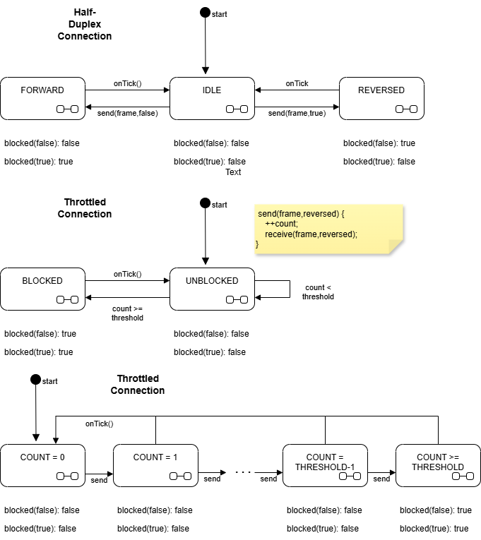
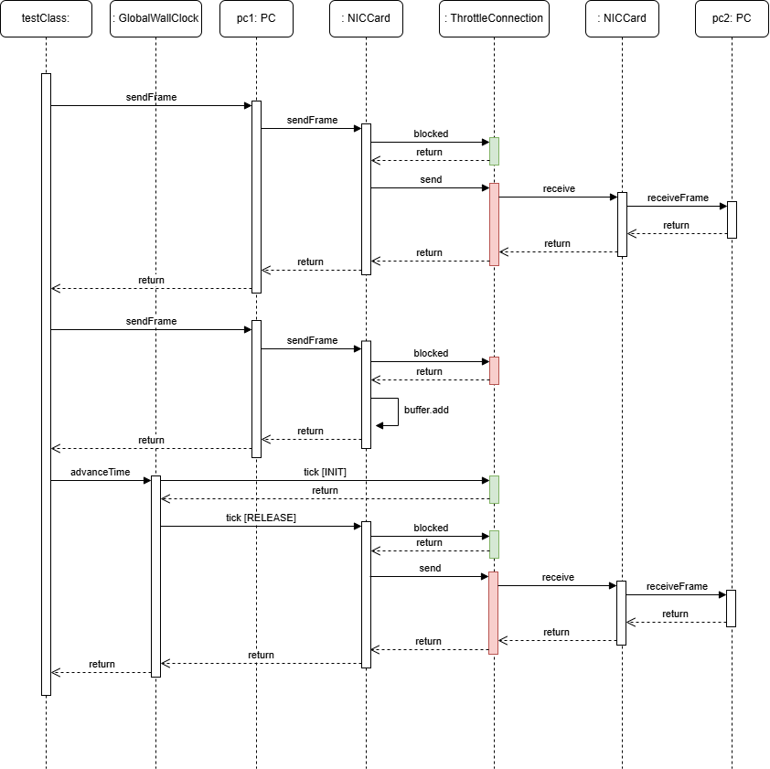
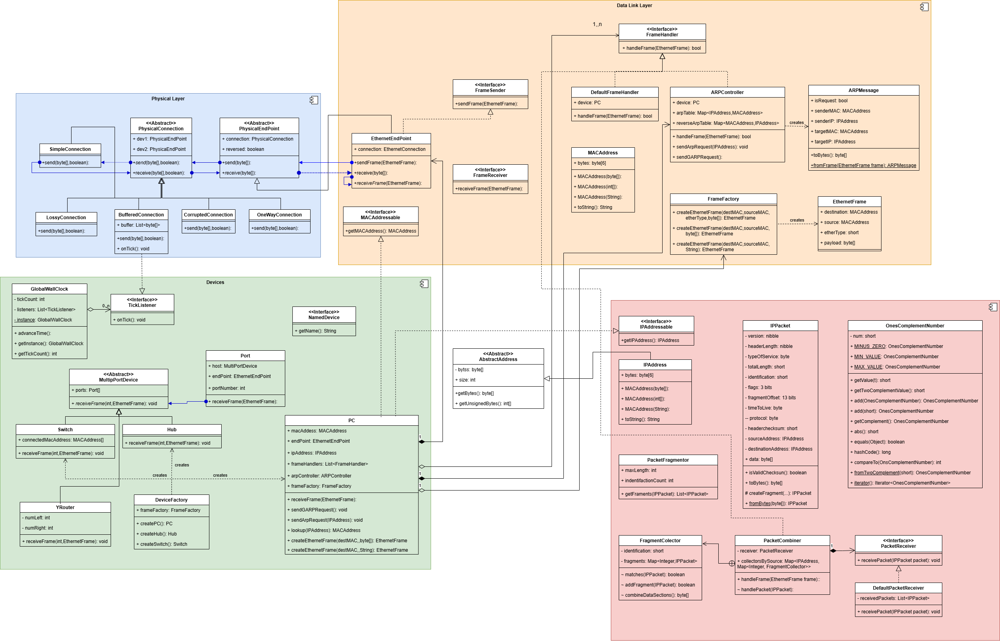

# Cables, Throttling and NIC cards - State Machines

## User Story

As a WAN network engineer I want to ensure that I do not send more data
down a connection than it can support, so end users can send their data
and ensure it eventually gets through.

## Acceptance criteria

Scenario: large numbers of frames can be transmitted through slow connections

* Given: two PC's connected with a throttled connection
* When: One PC send a large IPPacket.
* Then: The packet is fragmented
* Then: the fragments are packaged in frames and sent to the NIC card.
* Then: the NIC card sends frames until the connection is blocked
* Then: the connection send frames to the other PC
* Then: fragments are collected as by the other PC
* When: time is advanced
* Then: the NIC card sends the next block of packets
* When: time is advanced by 10 tick
* Then: the second PC combines fragments into a complete package
* And: the recombined packet matches the original

## Specification

1. A `ThrottledConnection` can only accepts a given number of frames a clock tick.
    * It implements the `BlockingConnection` interface that has a `boolean blocked(boolean reversed)` method to indicate whether its `send(byte[],reversed)` can be called.
    * If the number of frames sent in a given tick exceeds a given limit then `blocked` will return true.
    * The count is reset on each clock tick.
    * Constants `CAT3` 16 MHz, `CAT4` 20 MHz, `CAT5` 100 MHz, `CAT6` 250 MHz,
    `CAT7` 600 MHz, `CAT8` 2 GHz, define the number frames that can pass
    per clock tick. The MHz rating is interpreted as the number frames that can be transmitter per tick. So a CAT3 can transmit
    16 frames per tick and a CAT8 can transmit 2000 frames.
2. A `BufferedEndPoint` is an end-point that check the `blocked` method of it's connection.
    * If `blocked` returns false then the frame is sent to the connection.
    * Otherwise the frame is held in a queue.
    * It listens to the wall clock,
    * It's `tick` method checks the `blocked` status of its connection.
    * If blocked returns false, then frames are taken from the head of the queue and sent to the connection until the connection is blocked.
3. So the `ThrottledConnection` is cleared before the `BufferedEndPoint` the
    listeners to the `GlobalWallClock` can be added with a priority field.
    * Those with higher priority are called before those with lower priority.
    * Constants `INIT`, `RELEASE` are defined, INIT has higher priority.
    * `ThrottledConnection` has the INIT priority and `BufferedEndPoint` has the RELEASE priority.
4. A `HalfDuplexConnection` can only allow transmission in one direction per clock tick.
    * It has three states `FREE`, `FORWARD`, `REVERSED`
    * In the `FREE` state, frames can be transmitted in either direction
    * The first frame transmitted changes the state to `FORWARD`, `REVERSED`
    * In the `FORWARD`, or `REVERSED` state the `blocked(boolean reversed)` method
        returns false is the if the state matches the direction, allowing frames to be transmitted.
5. A `NICCard` or "network interface controller" is a `BufferedEndPoint` that
    implements `FrameSender` has has a `FrameReceive` provide in its constructor.
    * It can send and receive ethernet frames.
    * It has a buffer where frames can be stored before sending across its connection.
    * It converts ethernet frames to/from arrays of bytes, much like the `EthernetEndPoint`.

## Design

The `ThrottledConnection`  provides a simple model, but inaccurate, of different types of Cat cables.
The rate of data transfer in bits per second, is related to the bandwidth,
but not in as direct a fashion. Other factors like length and quality of cable also play a role. It could also potentially model the rate limit of connections across underseas cable in Wide Are Networks. This may prove useful when we look at routing strategies in the future.

Indeed, the whole physical_layer package is looking like an essential part of our test rig.

The `NICCard` mimic real network interface controllers that perform buffering on its
input and output.

The `HalfDuplexConnection` mimics two-wire cables that can only transmit data in one direction at a time. Cat5 cables have two twisted pair one for sending and one of receiving, so is a Full Duplex connection that can have packets going in both directions at the same time. It is include primarily as an example of the [state](https://refactoring.guru/design-patterns/state) design pattern:
> " a behavioural design pattern that lets an object alter its behaviour when its internal state changes. It appears as if the object changed its class."
It has three states IDLE, FORWARD and REVERSED and the behaviour of the `blocked(boolean)` method changes according to the sate.

`ThrottledConnection` is also an example of the state patten, it has two state: blocked and unblocked, it could also be considered as an n-state machine. We will look at more complex state machine when we look at the Border Gateway Protocol.

State machines are useful for many task, such as parsing a text file like the VRML 3D object format [VRML parser](https://github.com/RichardMorris/SingSurf4/blob/main/src/org/singsurf/singsurf/asurf/Vrml2Obj.java) that has states depending on which part of the file is being read: vertices, normals and faces.

### State Diagram

### Sequence Diagram

The interaction between the buffered NIC card and a throttled connection that only lets one frame through per tick can be shown in a sequence diagram.

## Challenges

1. Currently `ThrottledConnection` restricts the total number of packets in either direction. Create a `BiDirectionalThrottledConnection` that allows n packets in the forward direction and  n packets in the reversed direction per clock tick.

## Class diagram

