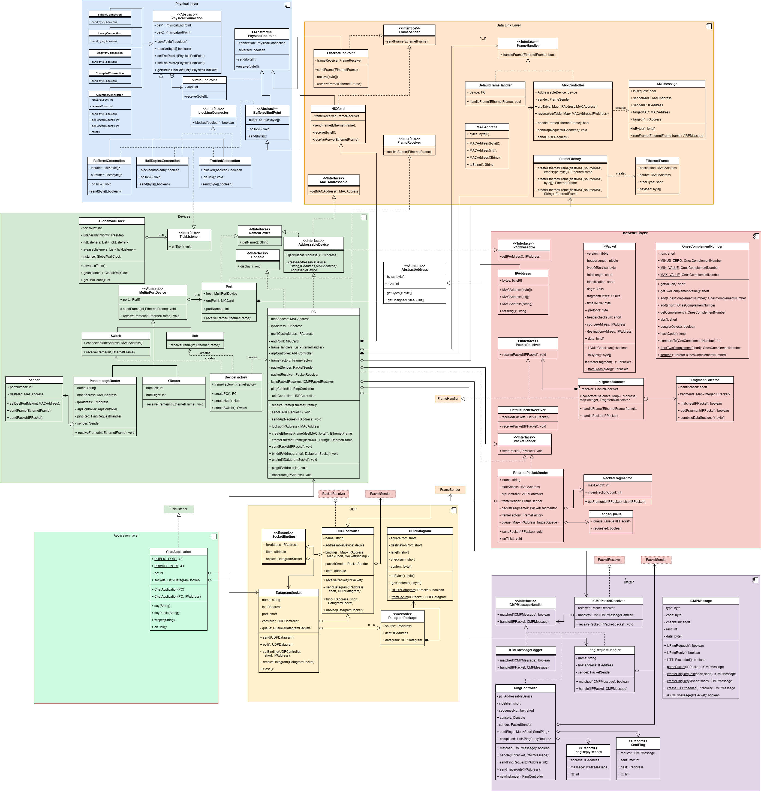

# Week 12 UDP, ports and sockets

## User Story

As a family, we want to chat each other via our PC on a local network
so we are kept up to date on everyone's messages.

## Acceptance Criteria

Scenario: A public lan chat application

* Given: A network of 2 PC's connected to a `Switch`
* When: The first PC starts the `ChatApplication`
* Then: The application creates a `DatagramSocket`
* Then: It binds the Socket to port 42 and multicast IP address on its `UDPController`
* When: The second PC starts the `ChatApplication`
* Then: The application creates a `DatagramSocket`
* Then: It binds the Socket to port 42 and multicast IP address on its `UDPController`
* When: The firstPC `says` a message
* Then: It creates a `UDPDatagram`
* Then: It sends the datagram to the socket
* Then: The UDP controller packages the datagram in an `IPPacket`
* Then: Breaks the packet into frames with the broadcast MAC and sends them to the `EndPoint` and across the network
* Then: The switch broadcasts the frames to the other machines
* Then: The second PC receives the frames
* Then: It recombines the frames into an IPPacket and send down its chain of responsibility
* Then: Its UDP controller receives the packet and extracts the `UDPDatagram`
* Then: It buffers datagrams for that port
* When: The second chat application receives a `tick`
* Then: The it calls the `poll` method of the socket
* Then: It receives the datagram and displays the content

Scenario: A private chat application
Given: a network of 4 PC's connected by two linked switched via a BlockingConnector.
When: PC1 starts the private chat application using PC4's IP address.
Then: It connects to a `DatagramSocket` bound to port 43 and PC4's address.
When: PC4 starts the private chat application using PC1's IP address.
Then: It connects to a `DatagramSocket` bound to port 43 and PC1's address.
When: PC1 `says` a message
Then: PC1 checks it ARPTable for the IP address
Then: It sends an ARPRequest
And: stores the message in a table
When: time is advance
Then: PC4 replies to the ARPRequest and updates its table
When: time is advanced
Then: PC1 receives the arp request and updates its table
Then: it recovers stored messages and sends them across the network.
When: time is advanced
Then: PC4 polls for messages
Then: PC4 displays the message.

Scenario: A private group chat
Given: a network of 4 PC's connected by two linked switched via a BlockingConnector.
When: PC1 starts the private chat application using PC4's IP address.
Then: it create a socket bound to port 43 and PC4's address.
Then: it create a socket bound to port 42 and multicast address.
When: PC1 `adds` PC3 IP Address
Then: it says `ADD_HOST 192.168.1.3` to current listeners PC4
Then: it says `ADD_HOST 192.168.1.4` to PC3
Then: it creates a socket  bound to port 43 and PC3's address.
When: A PC receives an `ADD_HOST` message
Then: creates a socket bound to port 42 and the IP address
When: PC1 `says` a message
Then: it is sent to PC3 and PC4 but not PC2
When: PC4 `closes` the chat
Then: it sends a `REMOVE_HOST 192.168.1.4` to both sockets
Then: PC1 and PC3 `close` their sockets
When: PC2 starts the public chat application
And: PC2 say "Time for tea"
Then: The message is sent to PC1 and PC3.

Scenario: unreliable connection
Given: two PC's connected by a blocking connector and lossy connector/corrupting connector
And: both PC have the public chat application open
When: PC1 `says` many large messages.
Then: each message is broken into fragments and sent across the connector
Then: some fragments are dropped
Then: PC2 recombines the fragments
When: a complete IP packet containing a UDP datagram is created
Then: PC2 displays complete messages
And: incomplete/corrupted message are never displayed

## Specification

1. The User Datagram Protocol is transport layer protocol
    * Its protocol number is 0x11 (17)
    * It is connection less, unreliable, not ordered, and fast.
2. A `UDPDatagram` is contained inside an `IPPacket`
    * Its header contains
        * Source Port: 2 bytes
        * Destination Port: 2 bytes
        * Length: 2 bytes
        * Checksum: 2 bytes, unused
    * Its data section contains the contents
3. A `UDPPacketController`
    * Is a `PacketReceiver`
    * Has a `nextReceiver` field specified in the constructor
    * Has a table linking ports to `Socket`
    * Tests if incoming packets matches the UPD protocol, otherwise forward the packet.
    * Extract a `UDPDatagram`
    * Finds the datagram application
    * Has a `bind(int,IPAddress,Socket)` method.
4. A `DatagramSocket` can send and receive `UDPDatagram` messages.
    * It can be bound to a port by the `UDPPacketReceiver`
    * Has an `Application` that receives decoded objects
    * Has a `send(UDPDatagram)` method that
        * Packages the object in a `UDPDatagram`
        * Sends the datagram to the bound port on the `UDPPacketController`
    * Has a `UDPDatagram receive()` method
        * Passes the object to its application.
        * Returns null if no datagram is available
        * (This conflicts with Java method that blocks until a datagram is available, but does not work with our
        model of time).
    * Has a `close()` method
5. A `ChatServer` is an application.
    * It creates a socket bound on port 42, and the LANS broadcast address `192.168.1.255`
    * It has a `say(String)` method that
        * Sends the message to the socket
    * Its `tick` method
        * repeatedly poll's the socket for a datagram
        * If a datagram is received displays the message it contains
6. Connectors can be joined together
    * PhysicalConnection has two `PhysicalEndPoint` inner classes.
    * A connection can have either of its endpoint set to null
        * If so `PhysicalEndPoint`
    * A connection has a `setEndpoint1(PhysicalEndPoint)` and `setEndpoint2(PhysicalEndPoint)` methods
    * A connection has a `PhysicalEndPoint getEndpoint1()` and `PhysicalEndPoint getEndpoint2()` methods
    * connections can be joined together

        ```java
        var buf = new BufferedConnection(PC1.getEndPoint, null);
        var loss = new LossyConnection(null,PC2);
        buf.setEndPoint2(loss.getVirtualEndpoint(0));
        loss.setEndPoint1(buf.getVirtualEndpoint(1));
        ```

    * when PC1 sends a frame
        * then `buf` is called with `send(frame,true)`
        * `buf` calls its second endpoints `receive(frame)`- loss's virtual end point 0
        * then virtual endpoint calls `loss.send(frame,true)`
        * `loss` calls its PC2 `receive(frame)` method
    * when PC2 sends a frame
        * then loss is called with `send(frame,false)`
        * `loss` calls it first end point's `receive(frame)` - buf's virtual end point 1
        * the end point calls `buf.send(frame,false)`
        * `buf` calls PC1 `receive (frame)` method.

## Status

We can now build complex networks with a variety of devices and a range of connections. This system has 3 PC connected by 2 switches.

```java
var pc3 = deviceFactory.createPC("PC3");
var sw1 = DeviceFactory.getInstance().createSwitch("Switch1", 4);
var sw2 = DeviceFactory.getInstance().createSwitch("Switch2", 4);
var connection1 = new BufferedConnection(pc1.getEndPoint(), sw1.getEndPoint(0));
var connection2 = new SimpleConnection(pc2.getEndPoint(), sw1.getEndPoint(1));
var connection3 = new CountingConnection(pc3.getEndPoint(), sw2.getEndPoint(0));
var connection4 = new ThrottledConnection(sw1.getEndPoint(2), sw2.getEndPoint(2),ThrottledConnection.CAT3);
```

The `ChatApplication` is our first application layer program, communicating through network sockets. The interface is similar to the Java's
[DatagramSocket](https://docs.oracle.com/en/java/javase/21/docs/api/java.base/java/net/DatagramSocket.html) with one change to reflect our timing model.
It can successfully conduct chats through these networks.



## Design

The overall design is an example of the port and adapter, or hexagonal architecture. Each layer in the stack exposes a couple of interfaces:

* Physical layer
  * `PhysicalConnection`: defines a port
    * `send(byte[] frame, boolean reversed)`
    * `receive(byte[] frame, boolean reversed)`
  * `PhysicalEndpoint`: an adapter to physical connections, defines a port
    * `send(byte[] frame)`
    * `receive(byte[] frame)`
* Data link layer
  * `FrameSender` and `FrameReceiver`: define a port for the data link layer
    * `send(EthernetFrame frame)`
    * `receive(EthernetFrame frame)`
  * `NICCard` and `EthernetEndpoint`: are adapters between physical and data link layers
  * `FrameHandler` defines a port to the network layer.
* Network layer
  * `PacketSender` and `PacketReceiver`: define a port for the network layer
    * `send(IPPacket packet)`
    * `receive(IPPacket packet)`
  * `IPFragmentHandler` is an adapter for the inward traffic from the data link layer it has
    * `receive(EthernetFrame frame)` method
    * that calls `receive(IPPacket packet)`
  * `EthernetPacketSender` is an adapter for outward traffic to the data link layer, it has
    * a `send(IPPacket packet)` that calls
    * `send(EthernetFrame frame)`
* ICMP
  * `ICMPPacketReceiver` is an adapter for inbound traffic from the network layer
  * `PingController` and `PingRequestHandler` use network layers `PacketSender` port for outbound traffic.
* UDP
  * `UDPController` is an adapter to the network layer
  * `DatagramSocket` provides an adapter the the application layer
    * `send(UDPDatagram message)`
    * `DatagramPacket poll()`

A common pattern should now become apparent:

* A protocol such  as ARP, IP, ICMP, and UDP has
  * A container type that hold the type of message that
    * Has fields for each field in the protocol
    * Can be constructed using values for the field
    * Can be queried to extract the values for the field.
    * Can be converted into a byte array
    * Its content can be converted to a byte array
    * Can be constructed from a byte array using a static method
    * static methods to check it can handle data from a lower level protocol
    * static methods to constructed from a lower level protocol
  * classes that receive messages
    * These have a set of handlers each handler
      * May match a higher level protocol or match a subtype of the protocol
      * Checks if message matches
      * handles matching messages
    * Have methods that register, and removes, handlers.
  * classes that send messages
    * These package the message up in a lower level protocol
    * Sends the package

Can we encapsulate this using design patterns or Java language features. Here generics map play a role.
Interfaces can be defined like

```java
interface MessageMatcher<T> {
    boolean match(T message);
}
```

and implementing class specify the actual message type

```java
class IPPacketMatcher implements MessageMatcher<IPPacket> {
    public boolean match(IPPacket message);
}
```

We look at this major refactoring in the next week.
