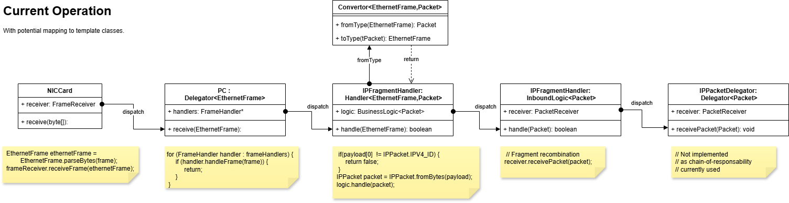

# Week 13 Generic Protocols

## User Story

As a software engineer I want to refactor my protocol stack with
a common interface so that it is easier to add new protocols
later.

## Design

A common pattern should now become apparent:

* A protocol such  as ARP, IP, ICMP, and UDP has
  * A container type that hold the type of message that
    * Has fields for each field in the protocol
    * Can be constructed using values for the field
    * Can be queried to extract the values for the field.
    * Can be converted into a byte array
    * Its content can be converted to a byte array
    * Can be constructed from a byte array using a static method
    * static methods to check it can handle data from a lower level protocol
    * static methods to constructed from a lower level protocol
  * classes that receive messages
    * These have a set of handlers each handler
      * May match a higher level protocol or match a subtype of the protocol
      * Checks if message matches
      * handles matching messages
    * Have methods that register, and removes, handlers.
  * classes that send messages
    * These package the message up in a lower level protocol
    * Sends the package

Can we encapsulate this using design patterns or Java language features. Here generics map play a role. The presence of many static methods may be a code smell.

## Generics

Interfaces can be defined like

```java
interface MessageMatcher<T> {
    boolean match(T message);
}
```

using a wild-card type indicator `T`.
Implementing class specify the actual message type

```java
class IPPacketMatcher implements MessageMatcher<IPPacket> {
    public boolean match(IPPacket message);
}
```

## Design idea

Lets see how this maps on to the common patter above.

* A protocol such  as ARP, IP, ICMP, and UDP has - represented by the `Protocol<T,L>` type
  * Has a container type `T`
  * Has a lower level protocol container type `L`
  * A container type that hold the type of message - implements `ProtocolContainer`
    * Has fields for each field in the protocol
    * Can be constructed using values for the field
    * Can be queried to extract the values for the field.
    * Can be converted into a byte array - implements `byte[] getBytes()`
    * Its content can be converted to a byte array - implements `byte[] getContents()`
  * Can construct from a byte array - `T fromBytes()`
  * Can check it can handle data from a lower level protocol `boolean match(L message)`
  * Can be created from a lower level protocol - `T fromContainer(L message)`
  * classes that receive messages - implement `MessageReceiver<T,H>`
    * These have a set of handlers each handler is of type `H` a message handler.
      * May match a higher level protocol or match a subtype of the protocol
      * Checks if message matches - implements `boolean matches(T message)`
      * handles matching messages - implements `T handle(T message)`
        * either return null to indicate no further processing
        * or a, potentially modified, message to be passed to the next handler
    * Have methods that register, and removes, handlers - implements `addHandler(H handler)`
  * classes that send messages - implements `MessageSender<T,L>
    * These package the message up in a lower level protocol - implements `L package()`
    * Sends the package - implements `void send(L message)`

The message handler uses the [template method](https://refactoring.guru/design-patterns/template-method) pattern, with a common algorithm

```java
class MessageDelegator<T extends ProtocolContainer, H extends MessageHandler<T>> 
    implements MessageReceiver<T> {
    List<H> handlers;
    public void receive(T message) {
        for(var h:handlers) {
            if(h.matches(message)) {
                message = h.handle(message);
                if(message == null)
                    return;
            }
        }
        Jns3Logger.logError()
    }
    public void addHandler(H handler) {
        handlers.add(handler);
    }
}
```

## Development

A large refactoring needs a careful plan, especially using generics, which are hard to get right.

1. Perform analysis on the current system, to find the classes and methods used in the actual processing of inbound and outbound message.
2. Develop a set of generic template class, that capture the key parts of the system.
3. Develop a simple set of test classes implementing the templates.
4. Expand the behaviour of test classes to match all current behaviour and expected future behaviour.
5. Replace current components in the system one by one with generic implementations, re-running whole test set as we go.

## Analysis



Inbound logic has two or three phases.

1. Handle data from the the lower level protocol, converting to the current level.
2. Perform some custom logic on data of this data, such packet recombination for fragmented IP packets. Potentially using data from the lower level protocol, UDP needs the IP address from the IPPacket and cannot just use the information in an UDP Datagram.
3. Delegate to a handler from a higher level protocol.

Outbound logic is generally simpler, but harder to generalise

1. Encapsulate a container from a higher level protocol in a lower level protocol, potentially using some extra information, such as the MAC address for a Ethernet Frame.
2. Perform some custom logic, like packet fragmentation.
3. Send to the lower level protocol.

## Delegation

Delegation is achieved via various mechanisms:

* For EthernetFrames this is performed by the `receiveFrame(EthernetFrame)` method in the PC class. This is performed by a for loop using the `boolean handleFrame(EthernetFrame frame)` method, defined in `FrameHandler`. There are 4 current implementing classes, `FrameChecker` that checks the CRC checksum, rejecting frames that fail; `ARPController` tests if the frame is a ARP request/response; `IPFragmentHandler` that checks if the frame contains IP packets.
* For IPPackets the chain-of responsibility is used, with each element in the chain implementing `PacketReceiver` with most classes having a `nextReceiver` field. There are 5 current implementations: `IPFragmentHandler` that receives packets containing fragments, it collects such packets, and later calls the next element in the chain; `ICMPPacketReceiver` checks and processes ICMP packets; `UDPController` checks and processes UDP datagrams.
* For `ICMP` messages, the `ICMPPacketReceiver` acts as both the `PacketReceiver`, convertor to `ICMPMessage` and delegator to `ICMPHandler` classes. Currently only 3 handlers: `PingRequestHandler`, `PingController` and `ICMPMessageLogger`. Here handlers implement two methods `boolean match(ICMPMessage)` and `void handle(IPPacket,ICMPMessage)`
* For `UDP` datagrams `UDPController` does all the work of handling and converting IPPackets. Here delegation is complex, selecting a single `DatagramSocket` based on the IP address in the IPPacket, and the socket from the datagram. Keeping the `bind` system for registering delegates is an important design goal, so imposing the same generic system at the application layer may not work here.

In the future we will expect to implement:

* TCP another transport layer protocol, that receives IP packets and uses a similar socket/bind mechanism to UDP,
* DHCP an application layer protocol for assigning IP addresses on a local router that uses UDP.
* HTTP an application layer protocol that uses TCP.
* IEEE 802.11 a data link layer protocol for WI-FI communication.
* Routers - these will have their own stack of protocol's.

The design went through several implementations

1. Use two methods `boolean match(T type)`, `T handle(T type)`, has no way to communicate a error state.
2. Use a single method with a return code `State handle(T type)` where state is `Handled`, `Ignored`, `Error`.  Has no way to modify a packet and pass it back to the handler, needed by routers that decrease TTL in IP packets.
3. Use a single method with a return code, `State handle(T type)`, with a forth state `Modified` that included the modified message. Proved to be hard to implement cleanly
4. Use a "callback mechanism" where the delegator is passed as an argument, `State handle(T type, Delegator<T> delegator)`. Was quite flexible allowing mirroring of messages, where one handler can consume the message, but also return a modified message, but would not cope with IP packet recombination, where the packet is only sent down the chain after many packets have been received.
5. Use a callback mechanism where the callback method is set during initialisation. A single method `State handle(T type)`, with a further method `setInboundCallback(ProtocolReceiver<T> r)` set during initialisation. The most flexible system.
6. Possibly use a similar callback for the outbound stage.

The  [template method](https://refactoring.guru/design-patterns/template-method) for delegators then becomes

```java
for (var handler : handlers) {
    var state = handler.handle(message);
    switch(state) {
    case Handled h -> { return; }
    case Ignored i -> { break; }
    case Invalid i -> {
        Jns3Logger.logError(name, "Invalid message: " + i.reason);
        return;
        }
    }
}
```

This uses [JEP 406: Pattern Matching for switch](https://openjdk.org/jeps/406) to choose a case based on the the type of the argument. The state is represented by subclasses of a `Status` class:

```java
public static sealed interface Status permits Handled, Ignored, Invalid {}
public static final class Handled implements Status {};
public static final class Ignored implements Status {};
public static record Invalid(String reason) implements Status {}
```

The `sealed` prefix means only the three specified classes can implement the class, using the reasonable new java feature [JEP 409: Sealed Classes](https://openjdk.org/jeps/409).

## Initialisation

Ideally we would like to encapsulate the whole of the a stage in a single class, say `ProtocolA protA`, and `ProtocolB protB`, and register the higher level protocol with the lower level one: `protA.register(protB)`. Again several iterations were tried, the final solution was to have two interfaces `UpperPort<A>` and `LowerAdapter<A>` representing the upper side of the lower level protocol and the lower side of the upper level protocol respectively.

* `UpperPort<A>` has a single method `register(LowerAdapter<A>)`.
* `LowerAdapter<A>` has three methods to provide information to the port and query information.
  * `List<ProtocolHandler<A>> getInboundHandlers()` provide the handlers.
  * `void setInboundCallback(ProtocolReceiver<A> r)` set the callback if needed.
  * `void setOutboundSender(ProtocolSender<A> s)` sets the sender for outbound messages.

An intermediate protocol, with a single handler could then be define like:

```java
static class ProtocolB implements LowerAdapter<TypeA>, UpperPort<TypeB> {
    ProtocolSender<TypeA> senderA;
    ProtocolReceiver<TypeA> callbackA;
    ProtocolDelegator<TypeB> delegatorB = new ProtocolDelegator<>("pdb");
    ProtocolHandler<TypeA> logicHandlerAB = ...;

    @Override
    public void register(LowerAdapter<TypeB> adapter) {
        for(var h: adapter.getInboundHandlers()) {
            delegatorB.addHandler(h);
        }
        adapter.setOutboundSender(logicBA);
        adapter.setInboundCallback(delegatorB);
    }

    @Override
    public List<ProtocolHandler<TypeA>> getInboundHandlers() {
        return List.of(logicHandlerAB);
    }

    @Override
    public void setOutboundSender(ProtocolSender<TypeA> s) {
        senderA = s;
    }

    @Override
    public void setInboundCallback(ProtocolReceiver<TypeA> r) {
        callbackA = r;
    }
}
```

This could be considered an example of the [mediator](https://refactoring.guru/design-patterns/mediator)

> "a behavioural design pattern that lets you reduce chaotic dependencies between objects. The pattern restricts direct communications between the objects and forces them to collaborate only via a mediator object."


We can now set up a complex set of dependencies with one low level type `TypeA`,
one intermediate level type `TypeB` and two high level types `TypeC`, `TypeD`.
There are four associate protocols:

* `ProtocolA implements UpperPort<TypeA>`
* `ProtocolB implements LowerAdapter<TypeA>, UpperPort<TypeB>`
* `ProtocolC implements LowerAdapter<TypeB>`
* `ProtocolD implements LowerAdapter<TypeB>`

that can be linked together using

```java
var protA = new ProtocolA();
var protB = new ProtocolB();
var protC = new ProtocolC();
var protD = new ProtocolD();
protA.register(protB);
protB.register(protC);
protB.register(protD);
```

## Internal classes

Several generic interfaces define behaviour for internal components.

* `interface ProtocolType` defines the base type for a protocol, with methods to extract bytes of the whole package, or just its contents.
  * `public byte[] getBytes()`
  * `public byte[] getContents()`
  * `public boolean isValid()`
* `interface ProtocolConvertor<L extends ProtocolType, H extends ProtocolType>` defines two methods to convert to/from a lower level type.
  * `public H extract(L type)`
  * `public L encapsulate(H type)`
* `interface ProtocolHandler<T extends ProtocolType>` defines the method to attempt to handle a lower level type
  * `public Status handle(T type)`
* `interface ProtocolReceiver<T extends ProtocolType>` for classes that directly receive the inbound message, and callback.
  * `public void receive(T protocolType)`
* `interface InboundLogic<A extends ProtocolType,B extends ProtocolType>` for classes the need both the outer container and the extracted message.
  * `public void handle(A container, B extracted)`
* `interface ProtocolSender<T extends ProtocolType>` for classes involved in sending outbound messages.
  * `public void send(T protocolType)`
* `public class ProtocolDelegator<T extends ProtocolType> implements ProtocolReceiver<T>` the template method for delegation.
  * `public void receive(T protocolType)`

