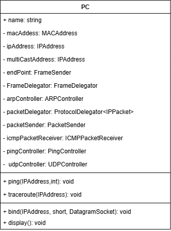
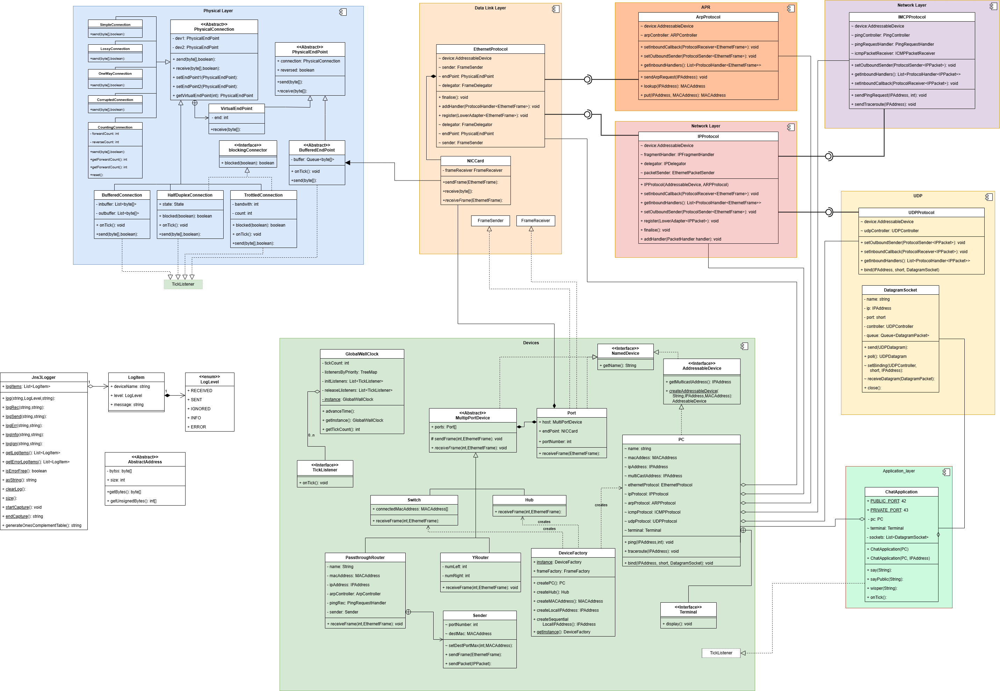
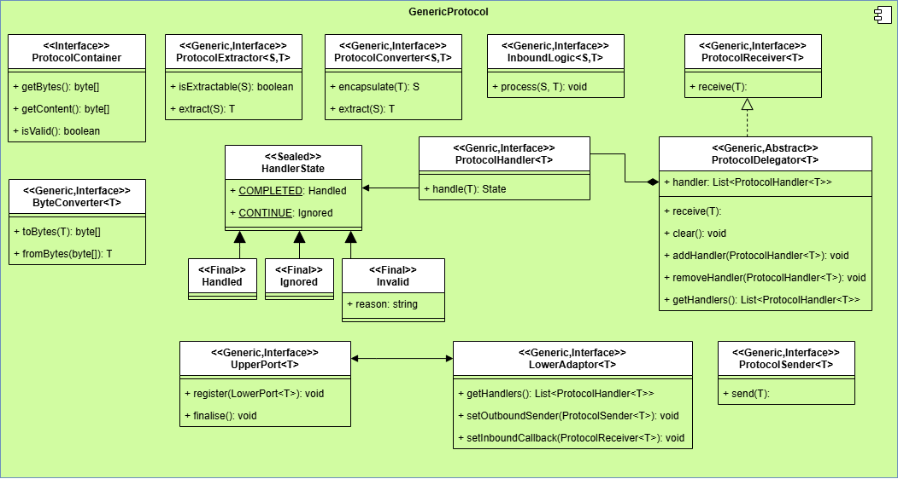

# Generics Refactoring

Now it's time to apply the Generic Framework to our current system.

## User Story

As a software developer I want to use the generic framework with the current implementation, so that:

* all protocol share a common pattern
* it is easier to add new protocols
* it is easier to configure a PC
* other types of devices like a router can be set up with it own custom logic
* the class diagram looks cleaner

## Acceptance Criteria

Scenario: Data-link layer

* Given: Data link layer is converted to use the generic framework
* When: link layer test are run
  * Then: All tests pass, with some changes in the configuration
  * And: a test protocol can be registered with the data-link layer
* When: A test protocol is registered
  * Then: the inbound logic works
  * And: the outbound logic works

Scenario: Network layer

* Given: Network layer is converted to use the generic framework
When: It is register with the data-link layer
* When: network layer test are run
  * Then: All tests pass, with some changes in the configuration
  * And: a test protocol can be registered with the data-link layer
* When: A test protocol is registered
  * Then: the inbound logic works
  * And: the outbound logic works

Scenario: ICMP

* Given: The ICMP package is converted to use the generic framework
When: It is register with the network layer protocol
* When: ICMP layer test are run
  * Then: All tests pass, with some changes in the configuration

Scenario: UDP

* Given: The UDP package is converted to use the generic framework
When: It is register with the network layer protocol
* When: UDP layer test and chat application test are run
  * Then: All tests pass, with some changes in the configuration

Scenario: Passthrough router

* Given: The Passthrough router is converted to use a custom stack of protocols
* When: All tests are run
  * Then: All test pass

Scenario: Physical Layer

* Given: A generalisation of the frame work is created to work with the `byte[]` data type.
* When: the data link layer is registered with the physical layer
* And: All tests are run
  * Then: all test pass

## Implementation notes

Converting the containers types proved relatively simple. The types converted are

* EthernetFrame
* ARPMessage
* IPPacket
* ICMPMessage
* UDPDatagram - logic for created and validating checksums created.

The process of encapsulating a container in a lower level type is more complex than last week as the creation process typically involves additional data.

Currently we have

1. `ARPMessages` to `EthernetFrames` in `ARPController`

    ```java
    var garpFrame = frameFactory.createEthernetFrame(
        MACAddress.BROADCAST_MAC,
        device.getMACAddress(),
        ARPMessage.ARP_ETHER_TYPE,
        garpMessage.getBytes());
    ```

2. `IPPacket` to  `EthernetFrames` in `EthernetPacketSender`

    ```java
    EthernetFrame frame = frameFactory.createEthernetFrame(
        destMac, sourceMac, 
        p.getBytes());
    ```

3. `ICMPMessage` to `IPPacket` in `PingController` and `PingRequestHandler`

    ```java
    IPPacket packet = new IPPacket(
        IPPacket.IMCP, ttl,
        pc.getIPAddress(), destinationIP, 
        pingRequest.getBytes());
    ```

4. `UDPDatagram` to `IPPacket` in `UDPController`

    ```java
    var packet = new IPPacket(IPPacket.UDP, 64,
        device.getIPAddress(), boundAddress, 
        datagram.getBytes()); 
    ```

5. `PC` exposed some of creation methods used in tests than have been inlined.

6. `FrameFactory` did not add any value, its method have been inlined and the class removed. Its method have been replaced by simple constructors.

    ```java
    EthernetFrame frame = new EthernetFrame(destMac, sourceMac, p.getBytes());
    ```

Extractors are still useful.

1. A generic interface `ProtocolExtractor` is defined

    ```java
    public interface ProtocolExtractor<
        L extends ProtocolContainer, 
        H extends ProtocolContainer> {
            public H extract(L type);
            public boolean isExtractable(L type);
    }
    ```

2. `ARPExtractor` implements an `EthernetFrame` to `ARPMessage` extractor.

3. `IPPackerExtractor` implements and `EthernetFrame` to  `IPPacket` extractor.

4. A generic `ByteConverter` interface is user between the physical and data-link layers

    ```java
    public interface ByteConverter<H extends ProtocolContainer> {
            public H fromBytes(byte[] bytes);
            public byte[] toBytes(H type);
    }
    ```

    With a single realisation `ByteToFrameConverter`.

Senders and Receiver these should be easy to implement with some method renaming.

* There were conflicts with the PC implement both FrameReceiver and PacketReceive. Rather than the IS-A relationship it is now a HAS-A relationship. Method to send/receive frames and packets have been inlined and removed. These did feel a bit odd as their are no corresponding OS system calls.
* PassThrough Router needed some changes as well.

Delegator and Handles are the trickiest parts to change.

1. Data Link layer was relatively painless.
2. For ICMP, the ping request handler can forward the packet. Hence it needs a PsudoHeader and the original packet.
3. UDP delegation uses the bind mechanism so we will not try to change that.
4. For IP delegation: the current system uses Chain of Responsibility. Implementing classes are:
    * IPFragmentHandler starts the call down the chain.
    * ICMPPacketReceiver
    * UDPController
    * DefaultPacketReceiver at end of chain.
5. This was relatively easy, only problems were with some tests, that used low level access. One test was dropped as there was a higher level test of the same behaviour. Other test used some ugly code to find the appropriate handler for checking logged packets.

After the first stage, all 145 test pass with 95% coverage, and 97 main classes and 29 test classes. 10 more main classes.

Virtually every class has been changed but the process was made quite easy by the refactoring tools available in Eclipse. Renaming a method causes the name to be changed in all calling code as well. Inlining can be done in a couple of clicks, and methods can be pulled up to their super class. Search for places than call a particular method proved to be useful in identifying which classes needed to be changed.

It's interesting to compare approaches of the different IDE's. In Eclipse it been in development for 20+ year with many tools designed for particular refactoring tasks. VSCode leaves most task to AI. I've found it much easier to use the hand crafted tools for this job, sometimes you don't want General Intelligence, but something crafted to do a particular job.

AI has proved useful, GitHub CoPilot did help with writing some boiler-plate code.

Examining coverage logs found some unused method, the `send(byte[] frame)` in `PhysicalEndPoint` and `PhysicalConnection` which are now dropped. The `PC.traceroute(IPAddress)` method was unused, test were changed to use this method rather than the lower level calls.

The PC class is now a pure Facade all functionality is passed
to other classes. Several methods have been dropped. There are still
too many component classes, this will be reduced when we introduce
Protocol classes in stage 2.  



## Stage 2 - Protocol Classes

## User Story 2

As a software engineer I want to use have a protocol class representing all the operations of a protocol so that:

* protocol classes share a common pattern
* protocol classes can be wired together
* it is easier to configure a PC or other devices
* internal components can be inspected

## Acceptance Criteria 2

Scenario: Double sided protocol

Applies to IP protocol

* Given: An intermediate level protocol, B with a lower level protocol A and higher level protocol C.
* When: It's protocol class is created
  * Then: All its internal components are created
  * And: A default set of handlers is provided.
  * And: Connection to a lower level is exposed through a `LowerAdapter<A>`
  * And: Connections to a higher level through an `UpperPort<B>`
  * And: Its internal components can be discovered by test classes

Scenario: Data-link-layer protocol

* Given: A data link layer protocol
* When: It's protocol class is created
  * Then: All its internal components are created
  * And: A default set of handlers is provided.
  * And: Connection to the physical layer is exposed through a `ByteAdapter`
  * And: Connections to a higher level through an `UpperPort`
  * And: Its internal components can be discovered by test classes

Scenario: physical layer protocol

* Given: A physical layer protocol
* When: It's protocol class is created
  * Then: All its internal components are created
  * And: A default set of handlers is provided.
  * And: Connections to a higher level through an `BytePort`
  * And: Its internal components can be discovered by test classes

Scenario: Upper layer protocol

Applies to ARP, ICMP, DHCP (to come)

* Given: An upper level protocol, B with a lower level protocol A and no higher layer protocol.
* When: It's protocol class is created
  * Then: All its internal components are created
  * And: A default set of handlers is provided.
  * And: Connection to a lower level is exposed through a `LowerAdapter<A>`
  * And: Its internal components can be discovered by test classes

Scenario: Transport Layer Protocols

Applies to UDP and TCP (to come)

* Given: A transport level protocol, B with a lower level protocol A and application protocol.
* When: It's protocol class is created
  * Then: All its internal components are created
  * And: A default set of handlers is provided.
  * And: Connection to a lower level is exposed through a `LowerAdapter<A>`
  * And: Connections to a higher level through an `ApplicationPort`
  * And: Its internal components can be discovered by test classes

Scenario: Application Layer Protocol

* Given: An application level protocol, B with a lower level transport protocol A.
* When: It's protocol class is created
  * Then: All its internal components are created
  * And: Connection to a lower level is exposed through a `ApplicationAdapter<A>`
* When: A client, server, or daemon application is created.
  * Then: It's handler can be register through the `bind` system call.
  * And: It can send and receive data through a `Socket<A>`
* When: an application closes it's socket
  * Then: It's handler is removed

Scenario: multiple data-link layer protocols

Applies to Ethernet, WI-FI (to come)

* Given: Two data-link layer protocol's and matching physical layers protocol's
* When: The protocols are created
  * Then: Their components are created.
  * And: Each has a separate MAC address.
  * And: They can be registered with the network layer

* Given: The protocols are registed with the network layer
* When: An outbound message is sent through the network layer
  * Then: It is directed to the correct protocol
* When: An inbound message is received, it is sent to network layer

## Implementation 2

1. Ethernet

    * Implemented as `EthernetProtocol implements UpperPort<EthernetFrame>` three components
    * `FrameDelegator` also acts as the `FrameReceiver`
    * `NICCard` acts as the `FrameSender` and `PhysicalEndPoint`
    * Two provided `ProtocolHandler<EthernetFrame>`
        * `FrameChecker` - should be first in sequence
        * `DefaultFrameHandler` - should be the last in sequence
    * Has an `addHandler` method that passes handlers to the delegator.
    * Has a `finalise` method that is called after other components are added, ensuring default frame handler is last called.
    * PC has a `setEthernetProtocol` method.

2. ARP

    * Implemented as `ARPProtocol`
    * Implements `LowerAdapter<EthernetFrame>`
    * Now in it's own sub-package.
    * Mostly just a wrapper around the `ARPController`
    * Methods like `lookup(IPAddress)` exposed through the protocol.
    * Some configuration issue as EthernetPacketSender needs the arp controller to lookup and requests.

3. IP

    * Implemented as `IPProtocol`
    * Implements `LowerAdapter<EthernetFrame>`
    * Implements `UpperPort<IPPacket>`
    * Has an `IPDelegator`
    * Has an `IPFragmentHandler`
    * Has an `EthernetPacketSender`
    * Has an `DefaultPacketReceiver`
    * It constructor requires and `ARPProtocol` argument.

4. ICMP

    * Implemented as `ICMPProtocol`
    * Implements `LowerAdapter<IPPacket>`
    * Has an `ICMPPacketReceiver`
    * Has three `ICMPMessageHandler` classes.
        * A `PingController`
        * A `PingRequestHandler`
        * A `ICMPMessageLogger`
    * The first two of these needed modification for deferred setting of their senders.

5. UDP

    * Implemented as `ICMPProtocol`
    * Implements `LowerAdapter<IPPacket>`
    * Just a wrapper around the `UDPController`
    * Exposes the `bind` method.

### Notes

Relatively painless. Only a few small changes to get all 145 tests to pass.

* In the register method the setters should be called before getters
to ensure all handles are initialised.

    ```java
    public void register(LowerAdapter<IPPacket> adapter) {
        adapter.setOutboundSender(packetSender);
        adapter.setInboundCallback(delegator);
        for(var h: adapter.getInboundHandlers()) {
            delegator.addHandler(h);
        }
    }
    ```

* The biggest change is with the `DeviceFactory.createPC()` builder.

  ```java
    public PC createPC(String name) {
        MACAddress mac = createMACAddress();
        IPAddress ip = createLocalIPAddress();
        var pc = new PC(name, mac, ip);
        // boot logic for the PC
        pc.setPacketReceiver(new DefaultPacketReceiver(pc.getName()));
        // Set up ICMP handler and add it to the packet receiver
        pc.setICMPHandler(new ICMPPacketReceiver(pc.getName(), pc.
            getPacketReceiver()));
        pc.setPacketReceiver(pc.getICMPHandler());
        pc.setPingController(PingController.newInstance(pc));
        pc.getICMPHandler().addHandler(pc.getPingController());
        pc.getICMPHandler().addHandler(new PingRequestHandler(pc, pc));
        pc.getICMPHandler().addHandler(
            new ICMPMessageLogger("ICMPLogger1"));
        // Set up UDP controller and add it to the packet receiver
        pc.setUDPController(new UDPController(pc, 
            pc.getPacketSender(),
            pc.getPacketReceiver()));
        pc.setPacketReceiver(pc.getUDPController());
        // Add frame handlers to the PC
        pc.addFrameHandler(new FrameChecker(pc));
        pc.addFrameHandler(pc.getArpController());
        pc.addFrameHandler(new IPFragmentHandler(pc, 
            pc.getPacketReceiver()));
        pc.addFrameHandler(new DefaultFrameHandler(pc));
        
        pc.setMulticastAddress(new IPAddress("192.168.1.255"));

        return pc;
    }
  ```

After

  ```java
      public PC createPC(String name) {
        MACAddress mac = createMACAddress();
        IPAddress ip = createLocalIPAddress();
        var pc = new PC(name, mac, ip);
        
        // boot logic for the PC
        
        EthernetProtocol ethernetProtocol = new EthernetProtocol(pc);
        pc.setEthernetProtocol(ethernetProtocol);
        
        ARPProtocol arpProtocol = new ARPProtocol(pc);
        pc.setArpProtocol(arpProtocol);
        ethernetProtocol.register(arpProtocol);

        IPProtocol ipProtocol = new IPProtocol(pc, arpProtocol);
        pc.setIPProtocol(ipProtocol);
        ethernetProtocol.register(ipProtocol);

        ICMPProtocol icmpProtocol = new ICMPProtocol(pc,pc.getTerminal());
        ipProtocol.register(icmpProtocol);
        pc.setIcmpProtocol(icmpProtocol);
                
        UDPProtocol udpProtocol = new UDPProtocol(pc);
        ipProtocol.register(udpProtocol);
        pc.setUDPProtocol(udpProtocol);

        ipProtocol.finalise();
        ethernetProtocol.finalise();

        pc.setMulticastAddress(new IPAddress("192.168.1.255"));

        return pc;
    }
  ```

Which is cleaner, with less details exposed of the internals of components.

## Class diagrams

The class diagram can be greatly simplified by using the five different Protocol implementations.



The generic framework has been modified a bit.



Diagrams for the internals of the protocols will wait a bit.
