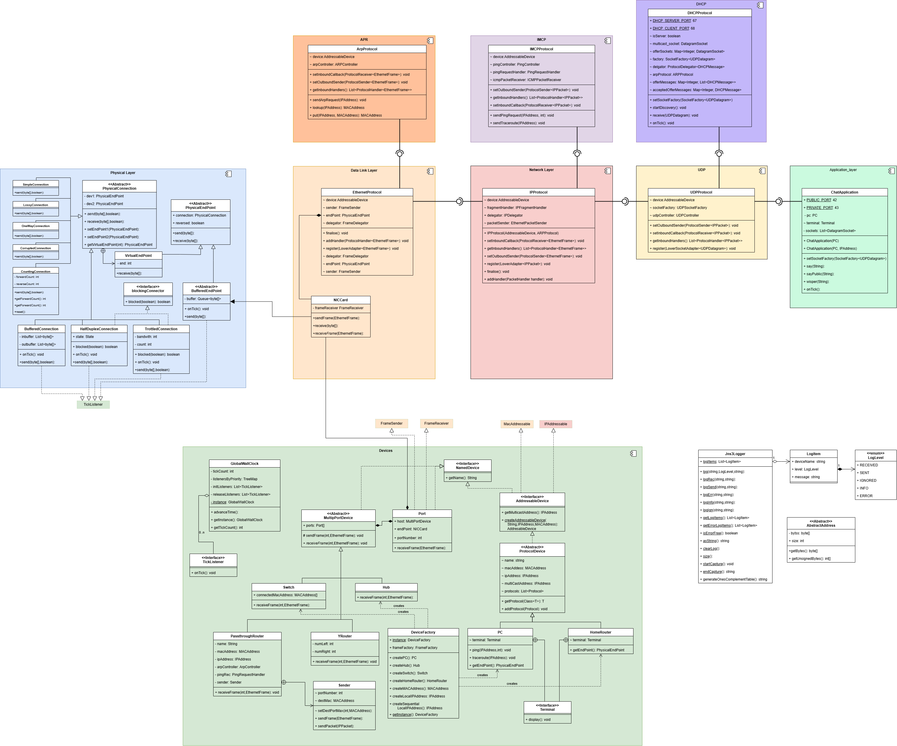
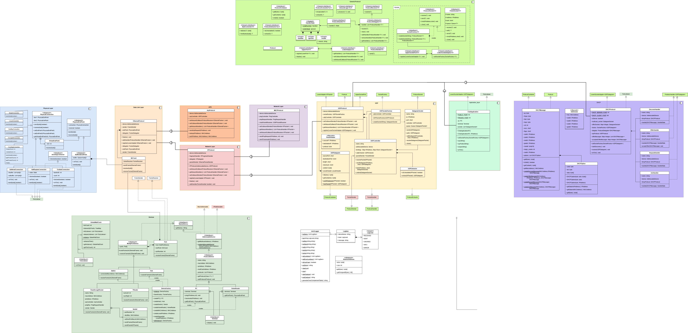

# Week 15 DHCP and the home routers

## User Story

As a home user, I want to connect to a home router and
automatically set up IP addresses
so I can send and receive messages to local network machines
and not have to worry about details like IP address conflicts,
whatever that means.

## Acceptance Criteria

Scenario: IP address allocation for local machines

* Given: A network of a PC and a HomeRouter
* When: The PC is connected
* Then: The PC requests IP address information from the router
* Then: The router supplies the information
* And: allocates a remote IP address for the machine
* When: The pc displays its ipconfig
* Then: it displays a message like

    ```text
    IPv4 Address. . . . . . . . . . . : 192.168.1.246
    Subnet Mask . . . . . . . . . . . : 255.255.255.0
    Default Gateway . . . . . . . . . : 192.168.1.1
    ```

Scenario: UDP (from last week)

* Given: The UDP package is converted to use the generic framework
* When: It is register with the network layer protocol
* When: UDP layer test and chat application test are run
  * Then: All tests pass, with some changes in the configuration

Scenario: Negotiation process per protocol

1. PC send a DISCOVER request with its mac address and all ip address 0
    * Sent to broadcast MAC and Limited MultiCast IP address.
    * EtherType should be (0x0800), not implemented
    * OP = 1
    * CHADDR = PC's mac address
    * All IP Addresses 0.
    * First option: 0x350101: Option 53 (DHCP Message Type) 1 octet (containing DHCPDISCOVER)
    * Second option: 0x3204c0a80164: Option 50 (Request IP address) 4 octets (containing current IP of client)

2. Router receives stores PC's MAC and IPAddress's in it arp table.
3. Router opens a socket
    * PC's current IP address
    * Ports 68

4. Router sends an OFFER message
    * Sent to the new socket.
    * OP is 0x02
    * CIADDR is zero
    * YIADDR is calculated by the router in the 192.168.1.0/24 range.
    * SIADDR with the local IP of the server 192.168.1.1
    * GIADDR is zero
    * First option: 0x350102: Option 53 (DHCP Message Type) 1 octet (containing DHCPOFFER)
    * Second option: 0x0104ffffff00: Option 1 (Subnet mask) 4 octets (containing 255.255.255.0)
    * Third option: 0x0304c0A80101: Option: 3 (Router) 4 octets (containing 192.168.1.1)
    * Fourth option: 0x330400015080: Option 51 (Address time) 4 octets (a 86400 second lease time)

5. PC receives the OFFER and stores the routers MAC and IP in arp table
6. PC opens a socket
    * Router's SIADDR
    * Ports 67
7. PC sends an REQUEST message
    * Sent to broadcast MAC and LimitedMultiCastAddress
    * OP is 0x03
    * CIADDR is zero
    * YIADDR as provided by router
    * SIADDR with the local IP of the server 192.168.1.1
    * GIADDR is zero
    * First option: 0x350102: Option 53 (DHCP Message Type) 1 octet (containing DHCPOFFER)
    * Second option: 0x0104ffffff00: Option 1 (Subnet mask) 4 octets (containing 255.255.255.0)
    * Third option: 0x0304c0A80101: Option: 3 (Router) 4 octets (containing 192.168.1.1)
    * Fourth option: 0x330400015080: Option 51 (Address time) 4 octets (a 86400 second lease time)
8. Router receives REQUEST
    * Checks the SIADDR matches otherwise skips.
    * Updates its APR table with YIADDR of client
9. Router sends a DHCP_ACK
    * Sent to the socket from Offer.
    * OP is 0x02
    * CIADDR is zero
    * YIADDR as in REQUEST.
    * SIADDR with the local IP of the server 192.168.1.1
    * GIADDR is zero
    * First option: 0x350105: Option 53 (DHCP Message Type) 1 octet (containing DHCPACK)
    * Second Option: 0x0104ffffff00: Option 1 (Subnet mask) 4 octets (containing 255.255.255.0)
    * Third option: 0x0304c0A80101: Option: 3 (Router) 4 octets (containing 192.168.1.1)
    * Fourth option: 0x330400015080: Option 51 (Address time) 4 octets (a 86400 second lease time)
    * Fifth option: 0x060c09070a0f09070a1009070a13:
Option 6 (Domain Server) 14 octets (containing 9.7.10.15,9.7.10.16,9.7.10.18)
10. PC receives the message
    * Updates its IP address with YIADDR

Scenario: Chat across local network

* Given: Two PC's connected via a HomeRouter
* And: both PC have negotiated their IP addresses with the router
* When: Both PC start private chats with the other IP addresses
* Then: Both PC can send and receive chat message

## Specification

1. Dynamic Host Configuration Protocol is a UDP protocol
    * Messages are sent on port 68
    * Messages are received on port 67
    * The payload have the format
        * OP - 1 byte op type, 0x01 for discover
        * HTYPE - 1 byte hardware type, 0x01 for ethernet
        * HLEN - 1 byte header length - 0x06
        * HOPS - number of hops, 0x00
        * XID - 4 bytes, 0x3903F326
        * SECS - 2 byte, 0x0000
        * FLAGS - 2 byte, 0x0000
        * CIADDR - Client IP address, 4 byte
        * YIADDR  - Your IP address, 4 bytes
        * SIADDR - Server IP address, 4 bytes
        * GIADDR - Gateway IP address: 4 bytes
        * CHADDR -Client Hardware address, 4 * 4 bytes
        * BOOTP Options - 192 octets all zero, not implemented
        * MAGIC COOKIE - marks end of options 4 byte 0x63825363
        * DHCP Options with first byte for type, second byte to length
            * first option (53,1) - DHCP Message Type - +1 bytes 0x350101, 0x350102, 0x350103,  0x350105
            * second option (1,4) - Subnet mask +4 bytes: 0x0104ffffff00
            * other options ignored, can include information about the Domain name server,
            available routers, Host name, Domain name
    * For DISCOVER requests
        * Frames are sent to the broadcast MAC
        * OP is 0x01
        * All ADDR fields are zero
    * For OFFER replies
        * Frame is sent to the senders MAC
        * OP is 0x02
        * CIADDR is zero
        * YIADDR is calculated by the router in the 192.168.1.0/24 range.
        * SIADDR with the local IP of the server 192.168.1.1
        * GIADDR is zero
    * For REQUEST replies confirming the offer
        * Frames are sent to the broadcast MAC
        * OP is 0x01
        * SIADDR with the local IP of the server who's offer was accepted 192.168.1.1
        * All ADDR fields are zero
    * For DHCPACK replies acknowledging the request
        * information is as in the OFFER, apart from the DHCP Message Type option

2. A `HomeRouter` moved to next week
    * Has a fixed IP address.
    * Has multiple ports.
    * Can negotiate DHCP with PC's on any port.
    * Forward multi-cast requests to all other ports.
    * Forwards ARP responses to correct MAC's.
    * Forwards IP Packets to correct port.

## Design Notes

The of the implementation involved a new `ProtocolContainer` - `DHCPMessage`.
Relatively straight forward, with record `DHCPAddresses` holding the quartet of IP addresses, and `DHCPOption` to hold the variety of options in Type-length-value ⋅format.

It soon became apparent that addressing acceptance criteria on extending generic to UDP and Application from the previous week. At some point in the future
when we implement TCP they will also communicate via a similar port-socket interface.

First we need to create several new generic classes:

1. An abstract `ProtocolSocket<T>` generalising the `DatagramSocket` from week 12.
    * It has a queue for inbound messages.
    * It has an `receiveDatagram(T datagram)` method that stores received datagrams in the queue
    * It has an `T poll()` method to check for received messages.
    * It has and abstract `void send(T datagram)` that sub-class must implement to send the datagram to the protocols sender.
    * It has `void bind(IPAddress address, short boundPort)` to open communication.
    * It has a `close()` method.

2. A `SocketFactory<T>` an [abstract factory](https://refactoring.guru/design-patterns/abstract-factory).
    > A creational design pattern that lets you produce families of related objects without specifying their concrete classes.

    Applications will use a socket factory supplied by the container. The UDP factory supplies `DatagramSocket` objects, and the TCP factory will supply `TCPSocket` objects. Our implementation is a generic version ensuring the type signatures match

    ```java
    public interface SocketFactory<T> {
        ProtocolSocket<T> createSocket(String name);
        ProtocolSocket<T> createSocket(String name, ProtocolReceiver<T> receiver);
    }
    ```

    When an application needs a socket it simple calls

    ```java
    socketFactory.createSocket(debuggingName);
    ```

3. A new port-adaptor mechanism is provided for protocols communicating via sockets.
    * `UpperSocketPort<T extends ProtocolContainer>` has a single method
        * `void register(LowerSocketAdapter<T> adapter)`
    * `LowerSocketAdapter<A extends ProtocolContainer>` has a single method
        * `void setSocketFactory(SocketFactory<A> factory)` providing the socket factory to the protocol or application.

4. `UDPProtocol` implements `UpperSocketPort<UDPDatagram>`, providing a `UDPSocketFactory`.

5. The ChatApplication
    * implements `LowerSocketAdapter<UDPDatagram>`
    * To start working with sockets the application
        * Gets the UDPProtocol from the PC, `var udpProtocol = pc.getUDPProtocol();`
        * Registers with the protocol, `udpProtocol.register(this);`
        * This calls the applications `setSocketFactory(SocketFactory<UDPDatagram>)` method.
        * A socket is obtained `var socket = socketFactory.createSocket("PC-Chat");`
        * The socket is bound `socket.bind(ipAddress, port_num);`
        * Datagrams can then be sent with `socket.send(UDPDatagram)`
        * In coming datagrams be polled with the `UDPDatagram poll()`
        * If the second factory method `createSocket(String name, ProtocolReceiver<T> receiver)` has been used, then the receivers `receive(T)` method will be called directly rather than needing to wait for a tick. This is useful for daemon processes.

## DHCP

After the ChatApplication has been refactored and the tests suit passes, 
it time to create a new Protocol using the generic framework.

1. `DHCPMessage` implements `ProtocolContainer`
2. `DHCPExtractor` implements `ProtocolExtractor<UDPDatagram, DHCPMessage>`
3. `DHCPProtocol` :
    * Has two modes client, used by PC's, and server, used by routers.
    * implements `Protocol`, a marker interface for all protocols. 
    * implements `LowerSocketAdapter<UDPDatagram>` so it can be provided with a `SocketFactory`. 
    * implements `ProtocolReceiver<UDPDatagram>` used in the creation of sockets so incoming incoming datagrams are directly handled by the protocol rather than having the wait for a tick to poll the socket.
    * Has a `ProtocolDelegator<DHCPMessage>` to direct an incoming message to one of four handlers
        * `DiscoverHandler` responds to discover requests from the client
        * `OfferHandler` responds to offer replies from the server
        * `RequestHandler` responds to request requests from the client
        * `AckHandler` responds to acknowledge replies from the server
    * The first and third are implemented by the server and the second and forth by the client.
    * Has a `startDiscovery()` method to initialise the handshake process.
    * This broadcasts a Discover message.
    * The server's Discover handler
        * Stores the mac address and current IP of the requesting machine in its arp table.
        * Opens a socket to current IP, and the DHCP client port.
        * Stores the socket for later use
        * Sends a Offer message to the current IP.
    * The client's Offer handler:
        * Receives offer messages
        * Stores then in a map `Map<Integer, List<DHCPMessage>> offerMessages` of the protocol. This record the received offer messages, grouped by xid.
    * On every tick the client check to see if there has been any offer message, and accepts the first. It then
        * Sends a DHCP Request message.
        * Removes all offer messages for this xid.
        * Stores the first offer in the `acceptedOfferMessages` table.
    * The server receives the Request message.
        * Updates the arp table with the new allocated yiaddr.
        * Sends a DHCP Acknowledge message to the socket
        * Closes the socket
    * The client receives the Acknowledge message.
        * Updates its IP address.

The design of these classes is fairly straightforward. The tricky bit is getting the implementation close to the specification, which needs information from the data link layer about hardware address, and information from the network layer about IP addresses. The latter is stored in a `PsudoHeader` created by the UDP controller when it handles IP Packets.

To allow protocols to find each other a common marker interface `Protocol` is defied, all protocols implement this.

* A new abstract base class `ProtocolDevice` an `AddressableDevice`

  * It has a list of protocols used.
  * It has a method `void addProtocol(Protocol prot)`.
  * It has a method `T getProtocol(Class<T> cl)` to get a protocol using its class, used like

    ```java
    IPProtocol ipProt = getProtocol(IPProtocol.class)`
    ```

    implemented using some template trickery

    ```java
    public <T extends Protocol> T getProtocol(Class<T> cl) {
        for(Protocol p: protocols) {
            if(cl.isInstance(p)) {
                return cl.cast(p);
            }
        }
        // log error
        return null;
    }
    ```

* The current implementation of `HomeRouter` has a single port
  and a protocol stack similar to the `PC` apart from the `IMCPProtocol` running in server mode.

Making the `HomeRouter` allow multiple connections from machines in the local network is the subject of the next week.

## Class diagrams

Protocol level view



Detailed view of refactored UDP protocol and Chat Application, and ICMP protocol.




