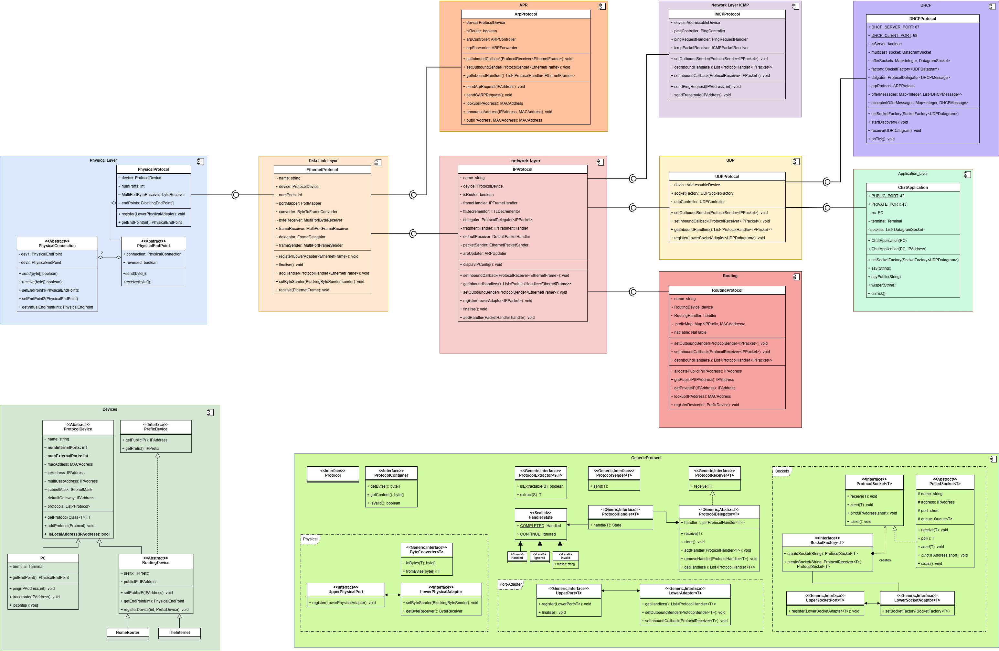
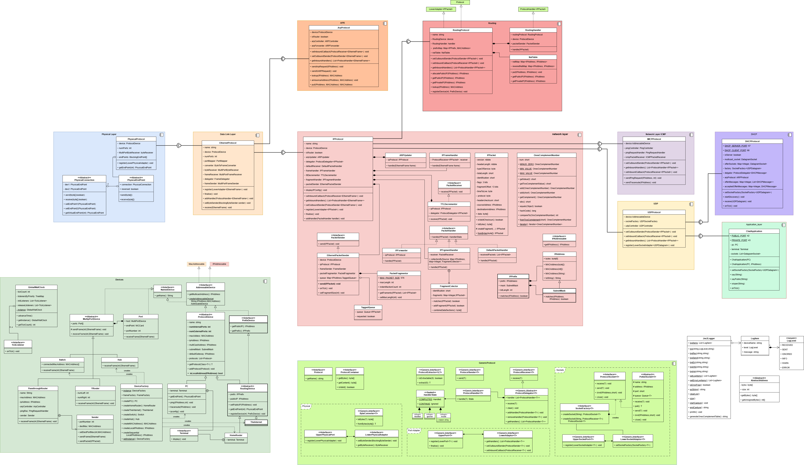

# Week 17 The Internet in a box

## User Story

As a teenager I want to chat to my friends over the internet, so I can keep track of all the gossip.

[Moss Introduces Jen To The Internet](https://www.youtube.com/watch?v=iDbyYGrswtg)

## Acceptance Criteria

Scenario: Router Configuration

* Given: Two Routers connected to TheInternet
* Then: They have different `IPPrefix` like `81.123.45.0/24`in the RIPE NCC `81.0.0.0/8` range (Europe, see [explain xkcd - map of the Internet](https://www.explainxkcd.com/wiki/index.php/195:_Map_of_the_Internet))
* And: A mapping of public IP addresses in the prefix range to private IP addresses in the 192.168.1.0/24 range.

Scenario: PC Configuration

* Given: PC1 connected to a HomeRouter1
* And: PC2 connected to HomeRouter2
* And: The two routers connected to `TheInternet`
* When: Both PC negotiate DHCP
* Then: They are assigned local IP addresses in the 192.168.1.2 to 192.168.1.250 range.
* And: They have subnet masks of 255.255.255.0
* And: The have default gateway addresses of 192.168.1.1
* And: They have public IP addresses assigned by the router.

Scenario: TheInternet configuration

* Given: Two routers connected to the internet.
* Then: It is manually configured to know the IPPrefixes of the routers.
* And: It has the IP address `195.66.226.16` the London Internet Exchange (LINX), the Primary Peering LAN in London.

Scenario: Ping

* Given: PC1 connected to a HomeRouter1
* And: PC2 connected to HomeRouter2
* And: The two routers connected to `TheInternet`
* When: PC1 pings PC2's Public IP address
* Then: The message is sent to HomeRouter1 using the default gateways mac address.
* Then: HomeRouter1 modifies the packet replacing the private IP with the public IP.
* Then: HomeRouter1 send the packet out of port 0, reserved for connection to the internet
* Then: The internet receives the packet and decrements the ttl
* Then: The internet sends to packet to the port with a matching IP Prefix
* Then: HomeRouter2 receives the packet
* Then: HomeRouter2 modifies the packet replacing the public IP with the private IP
* Then: It send the message to the port matching the private IP.
* Then: PC2 receives the message
* And: The TTL has been reduced by 3.
* Then: it replies to the ping
* Then: it passes back through the network
* Finally: PC1 displays the ping reply

  ```text
  PING 81.123.45.2 (81.123.45.2) 56(84) bytes of data.
  64 bytes from 81.123.45.2: icmp_seq=1 ttl=61 time=27.1 ms
  ```

Scenario: traceroute

* Given: Two PC connect via HomeRouters to the internet via buffered connections
* When: PC1 sends a traceroute to PC2 public IP
* Then: The traceroute sequence is completed
* And: PC1 displays

  ```text
  traceroute to 81.95.52.1, 64 hops max
  1   192.168.1.1  2 ticks
  2   195.66.226.16  4 ticks
  3   81.95.52.0  6 ticks
  4   81.95.52.1  8 ticks
  ```

Scenario: IPConfig

* When: The pc displays its `ipconfig`
* Then: it displays a message like

    ```text
    IPv4 Address. . . . . . . . . . . : 192.168.1.246
    Subnet Mask . . . . . . . . . . . : 255.255.255.0
    Default Gateway . . . . . . . . . : 192.168.1.1
    ```

Scenario: Chat across internet

* Given: Two PC connect via HomeRouters to the internet via buffered connections
* When: Both PC start private chats using each other's public IP addresses
* Then: Both PC can send and receive chat message

Scenario: ping to unknown IP

* Given: Two PC connect via HomeRouters to the internet via buffered connections
* When: PC1 sends a ping to unknown IP address
* Then: The internet receives the message
* Then: It responds with an ICMP Dest Unreachable message
* Then: PC1 store the warning message and logs a warning

Scenario: ping to unknown IP on remote network

* Given: Two PC connect via HomeRouters to the internet via buffered connections
* When: PC1 sends a ping to an IP matching a remote routers prefix, but does not match a machine
* Then: The remote router receives the message
* Then: It responds with an ICMP Dest Unreachable message
* Then: PC1 store the warning message and logs a warning

Scenario: chat to device not listening to port

* Given: Two PC connect via HomeRouters to the internet via buffered connections
* And: PC1 has started a chat with PC5
* And: PC5 has not started the chat
* When: PC1 says a message
* Then: The PC5 receives the message
* Then: It responds with an ICMP Port Unreachable message
* Then: PC1 store the warning message and logs a warning

## Specification

1. A `SubnetMask`
    * Is an `IPAddress` of the subnet mask  
    * Has a `boolean matches(IPAddress src, IPAddress dest)` method that
        * takes the logical AND of the src and dest addresses with the subnet masks
        * tests if the two results are equal.
2. A `IPPrefix`
    * Has prefix `IPAddress` like `138.253.39.0`
    * Has a bit-length like `/24`
    * Has a subnet mask calculated from the prefix and bit length
    * Can be constructed using a string like `192.168.1.0/24`
    * Has a boolean `matches(IPAddress dest)` method that
        * Finds the first bit-length bits of both addresses
        * Returns true if they are equal.
    * There are three prefixes used for local networks
        * Class A `10.0.0.0/8`
        * Class B `172.16.0.0/12`
        * Class C `192.168.0.0/16`
3. The `PrefixDevice` interface defines devices that has a `IPPrefix` used to route
    traffic to the device, and can be manually connected together for WAN traffic.
    * Extends `AddressableDevice`
    * It has a `IPPrefix getIPPrefix()` method.
    * It has a `IPAddress getPublicIP()` for its address on the internet.
    * It has a `registerDevice(int i, PrefixDevice dev)` method for manual configuration.
4. A `RoutingDevice` is a `ProtocolDevice` and a `PrefixDevice`
    * It has a fixed number of internal ports for LAN traffic
    * It has a fixed number of external ports for internet traffic.
    * It has a `RoutingProtocol` to manage routing of traffic over the internet.
    * It has a modified `EthernetPacketSender` for directing traffic
5. The `RoutingProtocol` manages routing
    * It has a `NATTable` that translates public to private IP's.
    * It has a `Map<IPPrefix, MACAddress>` that associate the MAC address to prefix.
    * It has an `allocatePublicIP(IPAddress localIP)` method that allocates public IP to each LAN device.
    * It has a `registerDevice(int i, PrefixDevice dev)` that updates its NATTable and prefix map.
    * It has a `MACAddress lookup(IPAddress addr)` method that tests the address against each prefix, returning the matching MaCAddress.
    * On construction it allocates a public IP to the device if needed, and adds the local and public IP's the the NAT table.
6. The `RoutingHandler` handles incoming IP packets
    * Packets for local destination IP's are passed to the next handler.
    * If the packet destination IP matches the device's prefix
        * The local IP is found from the NAT Table
            * If found the packet is modified to use this address
            * If not found the MAC addresses of source and destination are found
            * If the destination MAC is null or if it matches the source MAC, indication a loop
                * A ICMP host unreachable message is sent
    * The (modified) packet is sent to the packet sender.
7. The modified `EthernetPacketSender` route outbound traffic in multiple ways
    * Local traffic uses ARP to direct traffic to the local ports.
    * Traffic from the LAN to the internet
        * If a routing protocol is set then
            * Local source IP are converted to public IP addresses
            * The destination MAC address is found from the routing protocol.
        * Otherwise use the MAC of the default gateway.
    * Traffic from the internet to the LAN
        * Destination IP are converted to local IP by the routing handler.
        * The device's MAC address is used as the source MAC.
        * Arp protocol is used to find the dest MAC.
    * Traffic from the internet to the internet
        * Uses the device's MAC address as the source MAC
        * Looks up the destination MAC via the routing protocol
        * If not found send a IMCP Host unreachable message.
8. `TheInternet`
    * Is a `RoutingDevice` with 0 internal and 10 external ports.
    * It has a public IP and private IP' both 195.66.226.16
    * It has an APR protocol, but it handlers are not registered
    * It has a Routing Protocol
    * Other protocols as for a HomeRouter.
9. A `HomeRouter`
    * Is a `RoutingDevice` with 4 internal and 1 external ports.
    * Has a `IPPrefix` like `138.253.39.0/24`
    * Has a local IP address `192.168.1.1`
    * Has a `SubnetMask` of `255.255.255.0`
    * It has a Routing Protocol
    * It has all other protocol with the router option set.
10. PC's lookup of an IPAddress and sending a packet
    * PC checks the address against its SubnetMask
    * If it matches
        * Lookup address in ARPProtocol
        * If found use provided MAC address
        * If not found, send APR Request and queue packet
    * If it does not match
        * Find address of Default Gateway - here the address of the router that sent the DHCP Offer.
        * Send the frame to the MAC address of Default Gateway.


    ```text
    Type    DestMac     DestIP          SrcIP       Forward By  Ports
    ARP RQ  ff:..:ff    na              na          ARPFwd      2,3,4
    ARP RP  11:..:01    na              na          ARPFwd      1
    IP      11:..:02    192.168.1.3     192.168.1.2 LANFwd      2
    IP-LMC  ff:..:ff    192.168.1.255   192.168.1.2 LANFwd
                                                    MPFrmSnd    2,3,4  
    IP-Pub  11:..:00    81.123.45.2     192.168.1.2 RtrHdl

    ```

## Notes

We can finally drop the `ipswitch` package. The same functionality is now achieved by the routing protocol, closer to how routing works over the internet.

Logic for routing internet traffic is quite simple.

* Each registered device has a MAC Address and Prefix
* The MAC address is associated with a hardware port number
* To direct traffic to the correct port the the destination IP
    is tested against each entry in the PrefixTable.
* If found the corresponding MAC address is used in the outbound frame.
* The frame is directed to the correct outbound port.

The tricky part was ensuring the logic worked for the three main types of device, PC, HomeRouter and TheInternet, and with messages for all the different protocols.

Tests need to include the good-path for successful operation, as well as various bad path options. Now several part of code detecting error than were not included in the coverage reports can be return ICMP host unreachable methods, and test cases for these constructed.

Whether the `RoutingProtocol` should be an interdependent protocol, or part of the `IPProtocol` was one design decision. It's anticipated that routing will become more complex when we get to TCP and need to calculate the best routes between hosts, so we expect more complex code to emerge,
and the network layer package is already quite full.

## Class Diagrams

Protocol level diagram.



Modified components.


