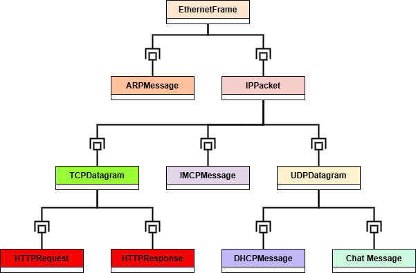
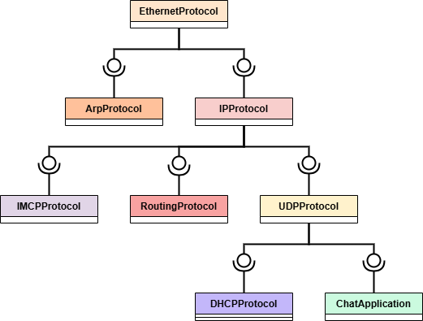
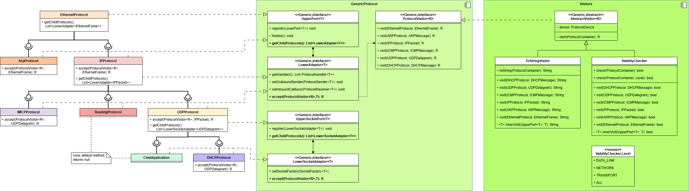

# Week 18 - A Generic Visitor for printing details of its frame and contents

## User Story

As a network engineer I want to inspect the content of frames seeing their encapsulated content, so that I can check for bugs in our implementation.

## Initial spec

Spec added in #32.

Each `Protocol<B>` with a `LowerAdapter<A>` has a `R accept(ProtocolVisitor,A)` methods that 
attempts to convert type A to type B and calls the visitors `R visit(this,B)` method providing double delegation.

Protocols keep a list of their registered protocols available by a getter.

`ProtocolVisitor<R>` has methods

* `R visit(EthernetProtocol, EthernetFrame)`
* `R visit(IPProtocol, IPPacket)`
* `R visit(ICMPProtocol, ICMPMessage)`
* `R visit(UDPProtocol, UDPDatagram)`
* `R visit(DHCPProtocol, DHCPMessage)`
* `R visit(LowerAdapter, ProtocolContainer)` - the default method for unknown protocols

`ToStringVisitor<String>` constructs a full string representation of a containers. it has methods

* `String visit(EthernetProtocol, EthernetFrame)`
* `String visit(IPProtocol, IPPacket)`
* `String visit(ICMPProtocol, ICMPMessage)`
* `String visit(UDPProtocol, UDPDatagram)`
* `String visit(DHCPProtocol, DHCPMessage)`
* `String visit(LowerAdapter, ProtocolContainer)` - the default method for unknown protocols

To convert an `EthernetFrame` containing an IMCP packet to a string call the visitors

The `String visit(EthernetProtocol, EthernetFrame)` method:

* First calls the frame's `String headerString()` method.
* Loops through its child protocols and calls their `R accept(Visitor,EthernetFrame)` method.
  * The ARPProtocol does not match the frame and returns null
  * The `InternetProtocol` matches the frame and calls the visitors `String visit(InternetProtocol,IPPacket)` method.

The `String visit(InternetProtocol, IPPacket)` method:

* First calls the packets' `String headerString()` method.
* Loops through its child protocols and calls their `R accept(Visitor,IPPacket)` method.
  * The RoutingProtocol and UDPProtocol do not match the frame and returns null
  * The `ICMPProtocol` matches the frame and calls the visitors `String visit(ICMPProtocol,ICMPMessage)` method.

The `String visit(ICMPProtocol,ICMPMessage)` method:

* Calls the messages `String headerString()` method.
* If necessary recursively calls the  `visit(InternetProtocol, IPPacket)` to print the original packet.
* returns the concatenated results with `tailString()`

The `String visit(InternetProtocol, IPPacket)` method:

* returns the concatenated results with `tailString()`

The `String visit(EthernetProtocol, EthernetFrame)` method:

* returns the concatenated results with `tailString()`

## Definition of Done

The definition of done is updated to reflect #31 it now requires

* JavaDoc is added for each new class
* Public and protected methods should have JavaDoc
* Simple getters need not have JavaDoc
* The @since tag should be used.
* Links to RFC's should be included.
* JavaDoc should complete without error.

## Design Notes

In [Week 3](Week3.md) the internet was represented as a tree of nodes, and we have not seen much evidence of trees since then. However there is a inherent tree structure in which containers encapsulate other containers. Some expected future packet types are included.



There is also a similar tree of which protocols are registered with each other.



There are several different operations we might want to do on such a tree:

* Producing a string representation of the a container and all its sub containers, for example, a DHCP discover message inside a UDP datagram, inside and IP packer, inside and Ethernet frame, can be printed as:

```text
EthernetFrame[destMAC=E4:34:C5:2B:95:18, srcMAC=8D:86:82:B4:41:C5, etherType=0x0800]
  IPPacket[ver=4,src=192.168.165.93,dst=192.168.37.77,hlen=5,tos=0,len=86,id=0,flags=0x02,offset=0,ttl=64,proto=17,checksum=0xA226]
    UDPDatagram[srcPort=68, destPort=67, len=66, check=0xA1E7]
      DHCPMessage[op=1, htype=1, hlen=6, hops=0, xid=0xBF4F10E2, secs=0, flags=0, ciaddr=0.0.0.0, yiaddr=0.0.0.0, siaddr=0.0.0.0, giaddr=0.0.0.0, chaddr=8D:86:82:B4:41:C5, options=2]
        DHCPOption[code=53, length=1, data=1]
        DHCPOption[code=50, length=4, data=192.168.165.93]
```

* Checking the contents of a frame, ensuring all it inner containers are well formed.

* Many possible future extensions:

  * Get the inner most container.
  * Produce structure diagram of the layout of a frame.
  * Fix up inner containers after changes to the outer container. For example when an IP address in a package is changed by a router, then the UDP datagram needs to have its check sum recalculated.

The [Visitor pattern](https://refactoring.guru/design-patterns/visitor)

> Visitor is a behavioural design pattern that lets you separate algorithms from the objects on which they operate.

Here we have a set of algorithms: string conversion, and validity checking, and a set of objects: different type of container. So the visitor pattern might be appropriate.

In the Jep system the visitor pattern is central to its operation, see [Design patterns in Jep](https://singsurf.org/djep/patterns.html). In that we have a tree of `Node` objects, which can have set of 0 or more child nodes. There are several sub type of Node `ConstantNode`, `VariableNode`, `FunctionNode`, `OperatorNode`. There is also a `NodeVisitor` interface defining methods

```java
interface NodeVisitor {
  Object visit(ConstantNode node, Object data);
  Object visit(VariableNode node, Object data);
  Object visit(FunctionNode node, Object data);
  Object visit(OperatorNode node, Object data);
}
```

The `Node` interface defines an accept method and each node class implements this method. They also have another methods return it's child node. For instance

```java
class OperatorNode implements Node {
  List<Node> children;

  Object accept(NodeVisitor visitor, Object data) {
    visitor.visit(this, data);
  }

  List<Node> getChildren() {
    return children;
  }
}
```

A simple visitor that counts the nodes would be implemented as

```java
class CountingVisitor implements NodeVisitor {

  int countNodes(Node node) {
    return (Integer) node.accept(this, null);
  }
  Integer visit(ConstantNode node, Object data) {
    return 1; // Constant nodes have no children
  }
  Integer visit(VariableNode node, Object data) {
    return 1; // variable have no children
  }
  Integer visit(FunctionNode node, Object data) {
    int sum = 1; // add the sum of all its children
    for(var child: node.getChildren()) {
      sum += (Integer) child.accept(this, data);
    }
    return sum;
  }
  Integer visit(OperatorNode node, Object data) {
    int sum = 1; // add the sum of all its children
    for(var child: node.getChildren()) {
      sum += (Integer) child.accept(this, data);
    }
    return sum;
  }
}
```

To count the number of children in a node tree the applications would:

* call `countingVisitor.count(rootNode)`
* this calls the `accept` method on the root node
* this calls the appropriate `visit` method on the visitor
* the visit method then calls the `accept` method on each child.

Hence we have a simple way of recursing down the tree.

Our case is a little different, rather than a tree of nodes, we have a tree of protocols and containers that may contain containers of different types, and we want a visitor that visits objects representing each encapsulated package. It took a few hours to figure out the correct framework: Should the accept method belong to the protocol, the container or something else? What arguments should the `visit` method take? The solution that worked was to use the `UpperPort` and `LowerAdapter` generic classes.

The `LowerAdapter` has `accept` method

```java
public interface LowerAdapter<A extends ProtocolContainer> {
  public default <R> R accept(ProtocolVisitor<R> visitor, A container) {
    return null;
  };
}
```

This is a [generic method](https://docs.oracle.com/javase/tutorial/extra/generics/methods.html) that has a type parameter `R` representing the return type. The method also a generic parameter
`A container` for the type from the lower protocol.

and the `UpperPort` has a `getChildProtocols` returning those protocols than have been registered.

```java
public interface UpperPort<T extends ProtocolContainer> {
  public void register(LowerAdapter<T> adapter);
  List<LowerAdapter<T>> getChildProtocols();
}
```

The `accept` tries ties to extracted container matching its protocol. If it matches the `visit` method is called with the protocol and extracted container as arguments., or `null` if the protocol does not match.

For example the IPProtocol has:

```java
public class IPProtocol implements Protocol,
       LowerAdapter<EthernetFrame>, 
       UpperPort<IPPacket> {

  @Override
  public <R> R accept(ProtocolVisitor<R> visitor, EthernetFrame frame) {
    var extractor = IPPacketExtractor.getInstance();
    if(!extractor.isExtractable(frame))
        return null;
    var packet = extractor.extract(frame);
    return visitor.visit(this, packet);
  }
}
```

It also implements UpperPort so has a method, to find the child protocols

```java
public class IPProtocol implements Protocol,
       LowerAdapter<EthernetFrame>, 
       UpperPort<IPPacket> {
  List<LowerAdapter<IPPacket>> childProtocols = new ArrayList<>();

  @Override
  public void register(LowerAdapter<IPPacket> adapter) {
    // snipped
    childProtocols.add(adapter);
  }

  @Override
  public List<LowerAdapter<IPPacket>> getChildProtocols() {
    return childProtocols;
  }
}
```

Most visitor extend `AbstractVisitor<R>` that provides a method that
calls the correct visit method for an unknown container type that we will discuss below.

A concrete visitor like the `ValidityChecker` will have methods for each pair of protocol type and container. Some of these are trivial

```java
public class ValidityChecker extends AbstractVisitor<Boolean> {
  @Override
  public Boolean visit(ARPProtocol protocol, ARPMessage message) {
    return message.isValid();
  }

  @Override
  public Boolean visit(ICMPProtocol protocol, ICMPMessage message) {
    return message.isValid();
  }
  // ...
}
```

The initial version had similar methods for the Ethernet and IP protocols:

```java
  @Override
  public Boolean visit(IPProtocol protocol, IPPacket packet) {
    if(!packet.isValid())
      return false;
    for(var child: protocol.getChildProtocols()) {
      var res = child.accept(this, container);
      if(res != null) { 
        return res; // only one protocol will match
      }
    }
    return true; // no child protocols matched, so the container is well-formed
  }
```

As they were similar another generic method is used for the common functionality.

```java
  private <T extends ProtocolContainer> Boolean innerVisit(UpperPort<T> protocol, T container) {
    if(!container.isValid())
      return false;
    for(var child: protocol.getChildProtocols()) {
      var res = child.accept(this, container);
      if(res != null) {
        return res;
      }
    }
    return true; // no child protocols, so the container is well-formed
  }

  @Override
  public Boolean visit(EthernetProtocol protocol, EthernetFrame frame) {
    return innerVisit(protocol, frame);
  }

  @Override
  public Boolean visit(IPProtocol protocol, IPPacket packet) {
    return innerVisit(protocol, packet);
  }
```

ToString visitor is similar, but with more complex logic inside the visit methods.

The base class uses a reasonably new Java  feature
[JEP 441: Pattern Matching for switch](https://openjdk.org/jeps/441) that has an advanced switch statement with cases selected by type.

```java
public abstract class AbstractVisitor<R> implements ProtocolVisitor<R> {
  protected ProtocolDevice device;
  public AbstractVisitor(ProtocolDevice device) {
    this.device = device;
  }

  protected R start(ProtocolContainer container) {
    switch(container) {
      case EthernetFrame frame -> {
        return visit(device.getEthernetProtocol(), frame);
      }
      case IPPacket packet -> {
        return visit(device.getIPProtocol(), packet);
      }
      case ARPMessage msg -> {
        return visit(device.getArpProtocol(), msg);
      }
      case ICMPMessage msg -> {
        return visit(device.getICMPProtocol(), msg);
      }
      case UDPDatagram datagram -> {
        return visit(device.getUDPProtocol(), datagram);
      }
      case DHCPMessage msg -> {
        return visit(device.getDHCPProtocol(), msg);
      }
    default -> throw new IllegalArgumentException("Unexpected value: " + container);
    }
  }
}
```

This framework allow new visitors to be easily implemented, they just need to provide implementation for the six visit methods. But what will happen when we add new protocol types?

Some are easy to implement, our chat application just uses ascii text inside the datagram, http, is similar. Here the `default` method for `accept` that just returns null. Other types may require a new `visit` method in the interface, and all existing visitors to be changed.

In true Agile fashion we will leave that problem for another day, when the need arises. This is likely to happen when
we get to the many protocols that depend on the Transmission Control Protocol, the TCP in TCP/IP.

The Visitor Pattern and Pattern matching for switch achieve the same result, indirection depending on the type of object.

## Class diagram

New methods in the protocol and how they relate to the
pattern.


