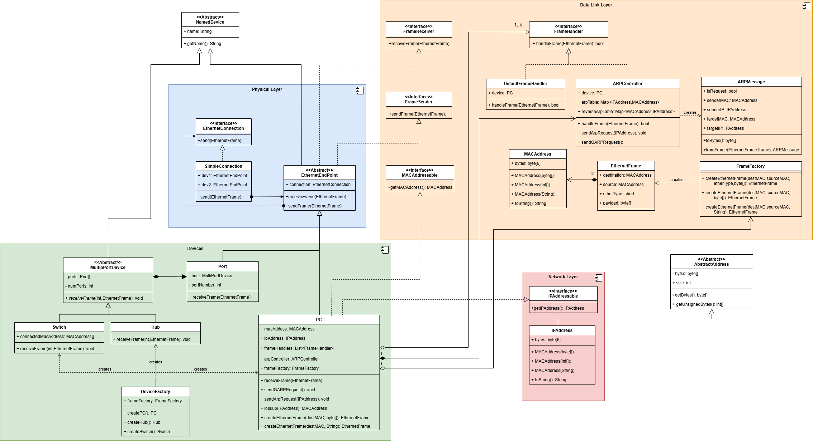

# week 6 - hubs and switched

## User Story

As a network engineer for a small company with multiple PC
I want to set up a network using hubs and switches so that
any PC can send a frame to any other PC on the network.

## Acceptance criteria

Scenario: arp initialisation of multiple PC's connected by a hub

* Given: three PC's connected by a hub, that do not know each others MAC addresses
* When: one pc tries to send a message to another IP address
* Then: the arp table is consulted and does not find the MAC address
* Then: and arp request is sent to the hub
* Then: the arp request is forwarded to the other PC's
* Then: the requested PC replies with an arp response
* Then: the hub forward the reply to all other PC's
* Then: the original PC updates its arp table.
* And: other PC have their arp tables updated

Scenario: sending messages across network of 3 PC's connected by a hub

* Given: three PC's connected by a hub, that know each others MAC addresses
* When: one pc tries to send a frame to another IP address
* Then: the frame is sent to the hub
* Then: the frame is forwarded to the other PC's
* Then: the requested PC receives and processes the frame

Scenario: sending messages across network of 3 PC's connected by a switch

* Given: three PC's connected by a hub, with ARP initialisation
* When: one pc tries to send a frame to another IP address
* Then: the frame is sent to the hub
* Then: the frame is forwarded to the correct PC's
* Then: the requested PC receives and processes the frame

## Specification

1. Hubs and Switched both have a number of Ports
2. A `Port` is a type of `Device`
    * It has a unique identification number.
    * Its `getName()` method returns the name of the host device and id number.
    * Its `getMACAddress()` and `getIPAddress()` methods report the value of the host device.
    * It has a `Connection` to one other device
    * The host device calls it `sendFrame(EthernetFrame)` method which
        send frames via the connection
    * When it receives a frame this is passed to the host device
    * If no device is connected then sendFrame logs an error.
3. Hubs and Switches both implement `MultiPortDevice` that
    * Has a fixed number of Ports
    * Has a `receiveFrame(int portNumber, EthernetFrame frame)` that
        receives a frame from a given port.
4. A `Hub` is a simple MultiPortDevice
    * It has a name used solely for reporting purposes.
    * It has an IPAdress and MACAddress but these are never used.
    * Its `receiveFrame` method sends the message every other Port's `sendFrame` method
    * It has no ARPConnection
    * It cannot initiate its own messages
    * Messages sent to its own MACAddress are recorded with an Error in the log.
5. A `Switch` is a MultiPortDevice
    * It has a name, IPAddress and MACAddress
    * It has a table the records the MACAddress of devices connected to each port.
    * Its `receiveFrame(int portNumber, EthernetFrame frame)` method:
        * If the destination address matches a known MACAddress, send the frame to the corresponding port.
        * If the destination address is unknown send the message to all other ports.
        * If the destination address is the broadcast MACAddress send the message to all other ports.
        * It checks that the source MACAddress matches the entry for that port. If it does not match update the table.  
    * It has no ARPConnection
    * It cannot initiate its own messages
    * Messages sent to its own MACAddress are recorded with an Error in the log.

## Design

This week introduces a new set of devices and poses some questions as to what properties are shared between the PC and the Hub/Switch as a single unit, and which properties are shared with the individual ports. The Device superclass from last week has been dropped, as this was not the most useful abstraction. Instead we have a `EthernetEndPoint` as a common base class between the `PC` and each `Port`, and `NamedDevice` for all things that have names, including `EthernetEndPoint`, `MultiPortDevices`. Names are primarily used for testing purposes via the Jns3Logger.

The core code behind a hub is very simple, it's consider a layer-1 device, and does not use MAC Addresses:

```java
for (int i = 0; i < numPorts; i++) {
    if (i != portNumber) {
        if (ports[i].isConnected()) {
            ports[i].sendFrame(frame);
        }
    }
}
```

We can't yet model the other weakness of hubs: that can't manage more than one incoming signal at a time. This will have to wait until week 9 and 10 where we introduce a model of time and blocking behaviour that allow us to model a half-duplex connection that only allows data to flow in one direction at a time.

Switches are not much more complex, our model has a 1-to-1 mapping between ports and the MAC addresses of devices at the other end of a connection. This has weaknesses in that we cannot chain two switches together, (why?)
The logic is not much more complex:

```java
public void receiveFrame(int incomingPortNumber, EthernetFrame frame) {
    // store the source MAC in the table
    var sourceMac = frame.getSource();
    connectedMacAddress[incomingPortNumber] = sourceMac;
    // find the port for the given destination MAC
    var destinationMac = frame.getDestination();
    int destinationPort = -1;
    for (int i = 0; i < numPorts; i++) {
        if (connectedMacAddress[i] != null &&
                connectedMacAddress[i].equals(destinationMac)) {
            destinationPort = i;
            break;
        }
    }
    // send to destination port
    if (destinationPort != -1) {
        if (destinationPort != incomingPortNumber) {
            if(ports[destinationPort].isConnected()) {
                ports[destinationPort].sendFrame(frame);
            } else {
                // log error, port not connected
            }
        } else {
                // log error trying to send back it itself
        }
    } else { // If the destination MAC address is unknown, 
            // broadcast the frame to all other ports like in a hub
        for (int i = 0; i < numPorts; i++) {
            if (i != incomingPortNumber) {
                if (ports[i].isConnected()) {
                    ports[i].sendFrame(frame);
                }
            }
        }
    }
}
```

## Red-Green-Refactor

There are several weaknesses in the design.  This is not really a problem as we are trying to follow a BDD/TDD approach, with Red-Green-Refactor:

* Write tests corresponding to the Acceptance Criteria. (Red - initial tests should fail)
* Only write enough code to make the test pass (Green - tests should pass)
* Use design pattern to help us refactor (Refactor)
* Other features that are not implemented yet, become backlog items for future weeks.

Refactoring only really becomes necessary when there are two tests, and two parts of code solving each test independently. Then you can refactor the code to make use some common structures to solve both tests at the same time.

There will be a lot of refactoring of this week's code, as we add more acceptance criteria.

Note the design does not always match the specification. The process of implementing code can shows problems with the specification.

## Challenges

Our implementation of a switch is broken, you can't have a network with two switches and transmit data to two different PC's connected to the other switch without broadcasting the traffic. Analysis why this happens, and fix it.

## Class Diagram


