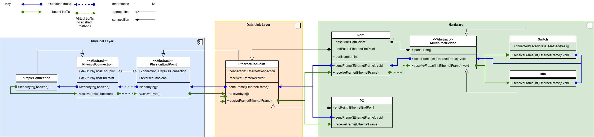
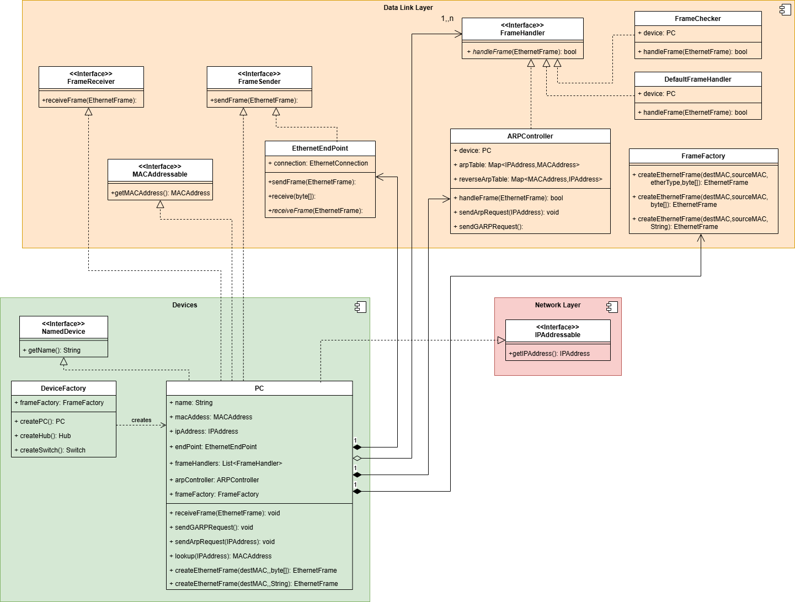
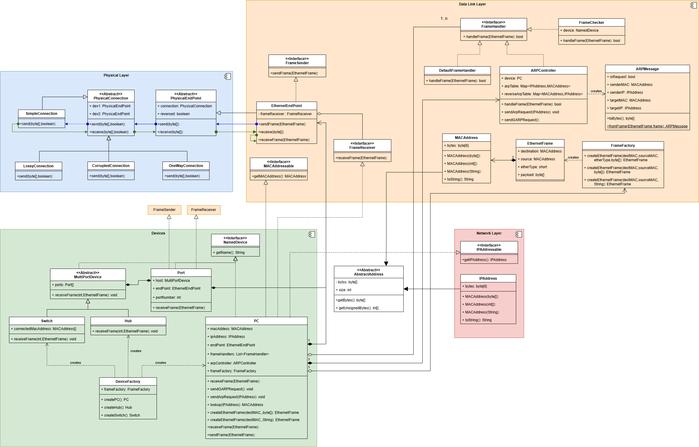

# Week 7 - Physical Layer

## User Story

As a network engineer working with imperfect network cables I need to
ensure only good frames get through
so errors are not created due to corrupted frames.

## Acceptance criteria

Scenario: transmission over imperfect cables

* Given: two PC connected with a CorruptedConnection
* When: A large number of frames are transmitted
* Then: some frames have their data changed
* Then: frames with invalid checksums are dropped.

## Specification

Too model the physical layer we have two key classes

1. `PhysicalConnection` this abstract base class represents a physical cable
    * It has two `PhysicalEndPoint` fields.
    * It defines a protected `send(byte[], boolean)` method that send a set of bytes down the cable in a given direction.
    * It provides a protected `receive(byte[], boolean)` method that
        concrete sub classes call to transmit data to the other end of the cable.
2. `PhysicalEndPoint` represents a cable socket.
    * It has an `send(byte[] frame)` method to send data down the connection
    * If defines an abstract `receive(byte[] frame)` to receive the data
    * It has a `PhysicalConnection` field.
    * It has a `reversed` field to represent which end of the connection the device is.
3. `EthernetEndPoint` represent the boundary between the data-link and physical layers
    * It has a `FrameReceiver` field set in the constructor.
    * It implements `FrameSender` providing a `sendFrame(EthernetFrame frame)` method
        that extracts bytes from the frame and calls `send(byte[] frame)`
    * It provides a `void receive(byte[] frame)` that creates and EthernetFrame from the
        bytes and calls the `receiveFrame(ethernetFrame)` implemented by subclasses.
4. There are a number of concrete implementation:
    * `SimpleConnection` simply transmits a frame from `send(byte[],boolean)` to `receive(byte[] boolean)`
    * `LossyConnection` drops every 10th byte.
    * `OneWayConnection` only allows frames in one direction, dropping others
    * `CorruptedConnection` on every 10th frame, modifies 1 bit.
5. Corrupted frames can be detected by using CRC-32 checksum.
    * An `EthernetFrame` has an 4 byte `frameCheck` field calculated during construction.
    * The frame check of a frame can retrieved using `int getFrameCheck()`
    * A recalculated frame check can found with `int calcFrameCheck()`
    * If the two values differ then the frame was constructed during transmission.
    * The `FrameChecker` is a `FrameHandler` that compares the two values.
        * It is the first handler called.
        * If the values differ, then `handleFrame` returns true stopping further processing.

## Construction

To create a simple network of 2 PC's.

1. Create a PC - pc1, which has an Ethernet endpoint
2. Create a PC - pc2
3. Create a `SimpleConnection` using

```java
new SimpleConnection(pc1.getEndPoint(),pc2.getEndPoint());
```

This links the connection and the two end points together.

## Operation

The sequence of operations for sending a frame from PC1 to PC2.

1. PC1 calls the `sendFrame(EthernetFrame frame)` method of it EthernetEndPoint
2. The `EthernetEndPoint` calls the `send(byte[])` method of its superclass `PhysicalEndPoint`
3. The physical endpoint calls `send(byte[], reversed)` of a concrete subclass of `Connection`
4. The connection optionally modifies the data
5. The connection calls `receive(byte[], reversed)` of the `Connection` superclass
6. The connection calls the `receive(byte[])` method of the other end point
7. The end point calls the `receiveFrame(ethernetFrame)` of PC2.

A simplified class diagram showing the passage of date through the system. It shows the path of outbound and inbound traffic, and also how classes in the chain are related to each other: either by inheritance, aggregation or composition.



## Design Patterns

1. `EthernetEndPoint` is an [adapter](https://refactoring.guru/design-patterns/adapter)

    > "Adapter is a structural design pattern that allows objects with incompatible interfaces to collaborate."

    Here the two interfaces are the physical layer that works with `byte[]` and the
data-link layer that works with `EthernetFrame`.

2. The different `Connection` classes are an example of the [strategy](https://refactoring.guru/design-patterns/strategy) pattern.

    > "Strategy is a behavioural design pattern that lets you define a family of algorithms, put each of them into a separate class, and make their objects interchangeable."

    Here the algorithm is transferring data from one end of a cable to the other, and
the different subclasses have different implementations.

3. PC is becoming much more like a  [Facade](https://refactoring.guru/design-patterns/facade). It provides a simple interface to a complex set of classes. It provides several methods that represent operating systems calls.
    * `sendFrame(EthernetFrame frame)`
    * `receiveFrame(EthernetFrame frame)`
    * `createEthernetFrame(MACAddress destinationMac, String payload)`
    * `createEthernetFrame(MACAddress destinationMac, byte[] payload)`
    * `sendGARPRequest()`
    * `sendArpRequest(IPAddress targetIP)`
    * `MACAddress lookup(IPAddress ipAddress)`
    * `addFrameHandler(FrameHandler frameHandler)`
The functionality of most of these methods is provided by other classes using composition
    * `EthernetEndPoint` for `sendFrame`
    * `FrameFactory` for `createEthernetFrame`
    * `ARPController` for `sendGARPRequest`, `sendArpRequest`, `lookup`
    * A list of `FrameHandler` for `receiveFrame`
Some simple getters are also provided:
    * `String getName()` defined by `NamedDevice`
    * `MACAddress getMACAddress()` defined by `MACAddressable`
    * `IPAddress getIPAddress()` defined by `IPAddressable`
    * `PhysicalEndPoint getEndPoint()` returning the `EthernetEndPoint`
    * `FrameFactory getFrameFactory()` returning the `FrameFactory`
    * `ARPController getArpController()` returning the `ARPController`
Boot logic setting all the PC components is currently provided in the `DeviceFactory.createPC()` factory method.

A simplified class diagram showing the PC and all the classes it depends on is shown below.



## Challenges

1. Implement some other types of connection
    * A `BrokenConnection` never transmits data.
    * A `NoseyConnection` representing a hacker intercepting bytes along the connection.
    * A `ReflectingConnection` send (some) data back to the calling device
    * An `OutOfOrderConnection` occasionally swapping the order of frames transmitted.
Implementing classes should:
    * extend `PhysicalConnection`
    * Supply a constructor `public BrokenConstructor(PhysicalEndPoint ep1,PhysicalEndPoint ep2)` than calls the super class constructor `super(ep1,ep2)`.
    * Implement the `protected void send(byte[] frame, boolean reversed)` method, possibly calling
        `receive(byte[] frame, boolean reversed)` normally passing through the `reversed` parameter.
2. (Hard) implement a `DelayedConnection` adding a delay to transmission. The `send` method should return before `received` is called allowing the sending device to continue operating. This will
require using Threads allowing different part of the system to run in parallel.

## Class diagram


